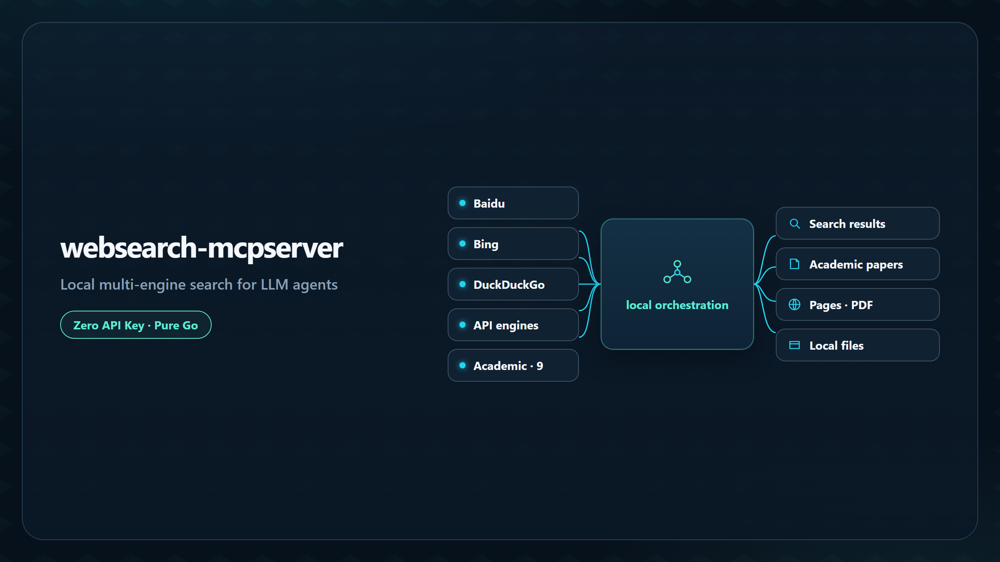
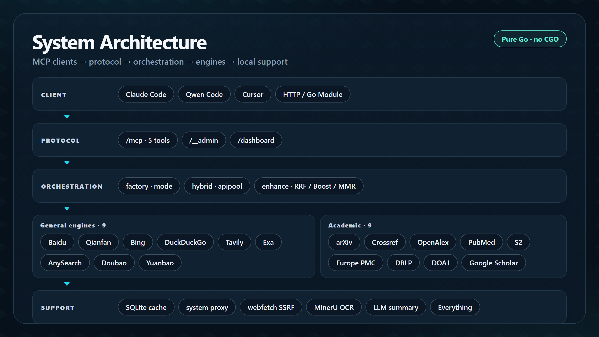
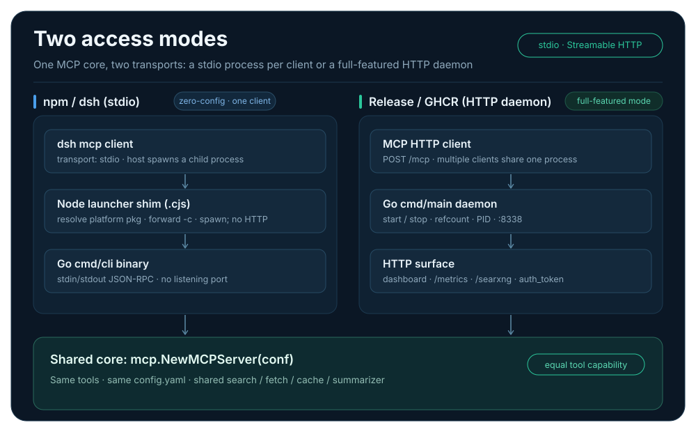
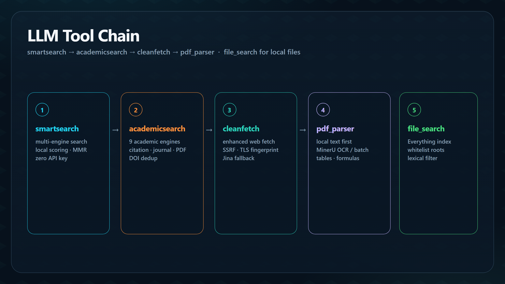
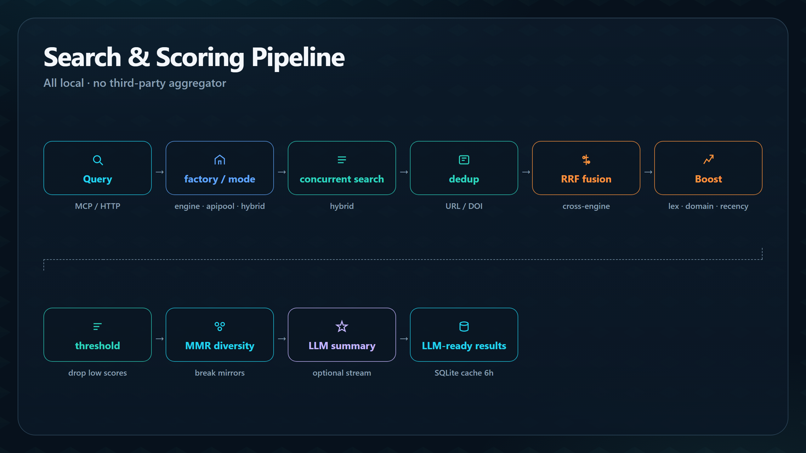
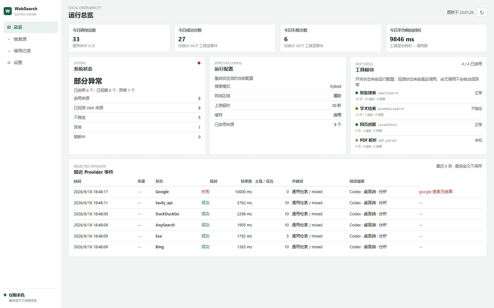

# websearch-mcpserver

> Lightweight Web Search MCP Server — runs with zero API keys

<p align="center">
  <a href="README.EN.md">English</a> · <a href="README.MD">中文</a>
</p>

<p align="center">
  <a href="https://go.dev/"></a>
  <a href="https://github.com/daidaiJ/websearch-mcpserver/releases"></a>
  
  
  <a href="LICENSE"></a>
</p>

<p align="center">
  
</p>

An MCP search service written in Go. Built-in Baidu web search, Bing, DuckDuckGo and other general-purpose engines, four zero-key hosted MCP upstreams (Parallel / AnySearch / Exa / Firecrawl), and 9 academic search engines. Search, scoring, and caching all happen locally. Use it as MCP tools in Claude Code, Qwen Code, or Cursor, or embed it as a Go module in your own service.

**Free, China-friendly, LLM-ready.** Works with zero keys; keys are used only when you provide them.

---

## Architecture at a glance

Layered design: clients see up to five MCP tools; the engine group is assembled by `mode`; scoring, cache, proxy, and fetch all run in-process. Queries never pass through a third-party aggregator.

<p align="center">
  
</p>

| Layer | Role |
|-------|------|
| **Client** | Claude Code / Qwen Code / Cursor / HTTP API / embed as a Go module |
| **Protocol** | `/mcp` up to five tools · `/searxng/search` for LiteLLM · `/__admin` process management · `/dashboard` optional local console · `/metrics` Prometheus observability |
| **Orchestration** | `factory` / `mode` · `hybrid` / `apipool` / `mcphub` · `enhance` (RRF / Boost / MMR) |
| **Engines** | General: Baidu web / Qianfan / Bing / DDG / Tavily / Exa / AnySearch / Doubao / Yuanbao / TinyFish / Keenable + 4 hosted MCP upstreams; 9 academic sources in parallel |
| **Support** | SQLite cache, system-proxy auto-detect, webfetch (SSRF), MinerU, streaming LLM summary, Everything |

### Two access modes: stdio and HTTP daemon

Both paths share the same `mcp.NewMCPServer(conf)` and the same `config.yaml`, so tool capabilities are equal. The difference is the transport and the management / observability surface:

<p align="center">
  
</p>

| | npm / dsh (stdio) | Release / GHCR (HTTP daemon) |
|---|----|----|
| Process | the dsh MCP client spawns one `cmd/cli` child per session | `websearch-mcpserver start` stays resident; refcount / PID across clients |
| Protocol | stdin/stdout JSON-RPC, no listening port | `POST /mcp` Streamable HTTP, `127.0.0.1:8338` by default |
| Tools | the same set of up to 5 tools | the same set of up to 5 tools |
| Exclusive | Node shim only resolves the platform package and `spawn`s it; no postinstall, no runtime download | `/dashboard/`, `/metrics`, `/searxng/search`, `/__admin`, `auth_token`, SSE progress |
| Config | falls back to in-memory `mode: engine` defaults; point `WEBSEARCH_MCP_CONFIG` at a personalized `config.yaml` | `start` writes a complete preset `config.yaml` on first run |

> **The HTTP daemon is the full-featured form.** stdio is not a stripped-down build, and it is not a thin client that starts the daemon: the Node shim only `spawn`s a binary, and that Go binary is already a complete MCP server — it simply listens on no port and has no management / observability surface. Config files are interchangeable between the two; see [docs/configuration.en.md](docs/configuration.en.md) for the field differences.

Fallback chain, proxy detection, and embedding details: [docs/architecture.en.md](docs/architecture.en.md).

---

## A complete tool chain for LLMs

Five retrieval tools feed into each other. Saved long search, webpage and PDF bodies are read through `cleanfetch` without client access to container files. Start at `offset=0`, then follow `next_offset` until `eof=true`.

<p align="center">
  
</p>

---

## Key Features

| Capability | Description |
|------------|-------------|
| Zero-key search | Recommended `mcphub`: hosted-MCP cascade over Parallel / AnySearch / Exa / Firecrawl with cooldown failover, no API keys required; `engine` mode uses local Baidu web + Bing instead |
| Multi-engine fusion | Multiple search modes, 9 general engines + 4 hosted MCP upstreams + 9 academic engines, auto-fallback on primary failure |
| Relevance scoring | RRF fusion ranking + lexical alignment / domain quality / consensus / authority / recency boosts, low-score results pruned; MMR breaks up mirrors / reposts |
| Response transparency | Failure lists, date and retrieval provenance; request cancellation propagates through every engine with a per-engine soft timeout; oversize search results retain candidate previews and a `result_ref` for complete body delivery through the `cleanfetch` saved-result mode |
| Academic search | 9 academic engines in parallel, scored by citation count / journal authority / PDF availability / recency; cross-engine DOI dedup |
| Web fetching | `cleanfetch` with built-in SSRF / DNS-rebinding protection and oversized-file pre-check; fallback to Jina Reader; optional `fetch_mode` reuses hosted MCP fetching |
| PDF parsing | Local PDFs prefer text extraction; scanned PDFs can fall back to MinerU OCR; remote MinerU returns the ZIP URL with images; when the source exceeds the per-task page limit (default 600), selected pages are cropped locally with qpdf, with configurable auto-batching and a per-call page budget ; bounded MinerU waiting with state and task references for resuming existing jobs |
| LLM summarization | Optional OpenAI-compatible API for structured summaries, with streaming progress |
| System proxy | Once Clash etc. enables the system proxy, overseas engines / Jina Reader use it automatically |
| Local file search | `file_search` uses the Everything index for millisecond path lookup, with directory allowlists and lexical filtering (requires Everything HTTP Server) |
| Local console | Optional `dashboard.enabled`, a read-only `/dashboard/` UI: call stats, source health, failure classes, whitelisted config edits, plus Prometheus-format `GET /metrics` (off by default) |
| Lightweight deploy | Single binary, no CGO, reference-counted process management, embeddable as a Go module |
| Chinese / English | `language: auto|zh|en` covers logs, MCP tool descriptions and parameter docs, and the console UI in one switch; `auto` follows the system language, and the console additionally negotiates per request from the browser language |

---

## Search & scoring pipeline

Results are not raw aggregation. After engines return, the server locally dedups, fusion-ranks, and re-ranks for diversity, then optionally summarizes:

<p align="center">
  
</p>

---

## Design Background & Goals

Existing MCP search solutions each fall short: vendor services (Tavily / Exa, etc.) require keys and per-use payment, route data through third-party servers, and are unstable from China; self-hosted SearXNG means maintaining a Python service and returns unoptimized raw aggregation. This project brings those capabilities back local: a single binary with multi-engine fusion, 9 academic sources, web fetch and PDF parsing — making search a **free, China-friendly, LLM-ready** basic capability.

The full project motivation, a dimension-by-dimension comparison with existing solutions, and the design principles (local-first privacy / zero cost to start / scalable complexity / decoupled and composable / a complete tool chain for LLMs / scenario-specific optimization) live in [docs/design.en.md](docs/design.en.md).

---

## Quick Start

```bash
# 1. Download: https://github.com/daidaiJ/websearch-mcpserver/releases
#    Prefer the platform archive (Windows .zip / Linux+macOS .tar.gz): both binaries, config samples and skills/
# 2. Start (no hand-written config, no API keys)
#    Windows auto-start on boot (optional)
./websearch-mcpserver.exe install
#
#    The first `install` writes an editable preset config.yaml and autostart.vbs next to the executable
./websearch-mcpserver start
#    Or double-click
autostart.vbs
# 3. Register with your MCP client (see docs/installation.md)
```

> "Zero config" = the first start writes a preset `config.yaml` identical to `config.example.yaml`; edit that file for port/keys/mode. The daemon listens on `127.0.0.1` by default; when opening the network (`host: 0.0.0.0`), configure `auth_token` to protect business endpoints.
>
> To use the zero-key hosted-MCP cascade, set `mode: mcphub` in that file (`mcp_hub.enabled` defaults to on).

Or use MCP Hooks for session auto start/stop (Qwen Code example; full details in [docs/installation.md](docs/installation.md)):

```json
{
  "hooks": {
    "SessionStart": [{ "matcher": "*", "hooks": [{ "type": "command", "command": "/path/to/websearch-mcpserver start", "timeout": 10000 }] }],
    "SessionEnd":   [{ "matcher": "*", "hooks": [{ "type": "command", "command": "/path/to/websearch-mcpserver stop",  "timeout": 10000 }] }]
  }
}
```

### Install via npm (dsh plugin / any MCP client)

Once a version's Release assets are ready, a separate `vX.Y.Z-npm` tag publishes the npm packages (`v3.10.5-npm` -> npm `3.10.5`): prebuilt per-platform binaries are selected automatically via `os` / `cpu`, with no postinstall, no runtime download and no API key. The Go binary ships in platform subpackages; the Node side is a ~90-line launcher shim.

```bash
# DeepSeek Harness: install as a one-line plugin (web profile)
dsh plugin --profile web add dsh-websearch-mcpserver
dsh --profile web --dump-config       # the mcp-websearch row should appear
dsh web                               # web bundles have no HMR; restart required

# Any other MCP client (Claude Code / Cursor / Qwen Code / ...): generic stdio CLI
npm i -g websearch-mcp-cli
```

```json
{
  "mcpServers": {
    "websearch": { "command": "websearch-mcp-cli" }
  }
}
```

> **Important: a fresh install only gets you "it runs". Getting the best results requires a personalized config.**
> With no config file the stdio binary uses in-memory defaults (`mode: engine`): search works, but you miss the zero-key hosted-MCP cascade, multi-provider key pools, academic-source weighting, fetch fallbacks, proxy handling, language and result budgets — the parts that actually decide result quality. The same server behaves very differently with a scenario-tuned config.

**Read the docs yourself, or have your agent read them** (recommended, saves time): humans start with the tuning path in [docs/HUMAN_GUIDE.en.md](docs/HUMAN_GUIDE.en.md) and the full reference in [docs/configuration.en.md](docs/configuration.en.md); agents should read [docs/AGENT_GUIDE.en.md](docs/AGENT_GUIDE.en.md) plus `docs/configuration.en.md` and `config.example.yaml`.

An npm install only gives you the Go binary — **the repo source is usually not on your machine**. The prompt below is therefore self-contained: it names the repository and the exact doc URLs, so you can paste it straight from the GitHub page into any agent without "this project" being ambiguous. If you already work inside a checkout, drop the fetch step.

```text
I installed websearch-mcp-cli / dsh-websearch-mcpserver via npm and need a
personalized config for it.
The repository is https://github.com/daidaiJ/websearch-mcpserver ; the config
docs live only there and I may not have the source on this machine. First check
whether the current directory is a checkout of that repo: if so read it directly;
otherwise clone it shallowly with
git clone --depth 1 https://github.com/daidaiJ/websearch-mcpserver to a temp dir,
or fetch these raw files:
  https://raw.githubusercontent.com/daidaiJ/websearch-mcpserver/master/docs/AGENT_GUIDE.en.md
  https://raw.githubusercontent.com/daidaiJ/websearch-mcpserver/master/docs/configuration.en.md
  https://raw.githubusercontent.com/daidaiJ/websearch-mcpserver/master/config.example.yaml
Then ask me about my OS, network (do I need a proxy), which API keys I have, and
my main use case (Chinese web / academic papers / code docs / deep research).
Generate config.yaml at an absolute path on my machine
(Windows: %USERPROFILE%\.config\websearch\config.yaml;
 otherwise ~/.config/websearch/config.yaml) with only the necessary overrides,
explain each choice, skip engines I do not use, and never write secrets in plain text.
Finally tell me the exact absolute path to put in WEBSEARCH_MCP_CONFIG and how to
verify it took effect.
```

Then export `WEBSEARCH_MCP_CONFIG=/abs/path/to/config.yaml` before launching dsh (the plugin shim turns it into `-c`); other clients can set the same variable under `mcpServers.websearch.env`, or pass `args: ["-c", "/abs/path/config.yaml"]`. Tune first: `mode` (`mcphub` for zero key / `apipool` with keys / `engine` fully local), `mcp_hub.preset` and `fallback_engines`, `sk_list`, system proxy, `language`, `fetch_mode`, academic engine switches, result count and timeout budgets, `cache`.

Non-`web` profiles, the platform matrix, checksums, permission disclosure and troubleshooting: [docs/installation.en.md](docs/installation.en.md#npm--dsh-plugin-distribution). Packaging and release notes: [npm/README.md](npm/README.md).

---

## Search Modes at a Glance

The single `mode` field decides the engine group: **use `mcphub` for zero-key deployments** (hosted-MCP cascade with cooldown and local-engine/Bing degradation); **use `apipool` when API keys are available** (multi-provider key rotation with automatic failover and web-engine fallback). `engine` remains the choice when only local web engines are needed and MCP is not desired; `baidu` / `tavily` / `exa` / `anysearch` / `doubao` / `yuanbao` are single-provider modes (they participate only with a key, with auto-fallback on failure); `hybrid` runs all engines concurrently. `mcphub` also supports `rotation_engines` to share load with local engines and automatically enables/skips proxy-required upstreams. Missing keys auto-degrade to `engine`.

Participating engines per mode, key-signup links, `sk_list` multi-key rotation, and per-engine rate limits: [docs/search.en.md](docs/search.en.md).

The four built-in `mcphub` presets:

| Preset | Proxy by default | Notes |
|--------|------------------|-------|
| `parallel` | No | Directly reachable, lowest latency |
| `anysearch` | No | China-friendly direct access, stable Chinese results |
| `exa` | Yes | Lower anonymous rate limit |
| `firecrawl` | Yes | Anonymous quota allocated per egress IP |

- Default cascade is `parallel → anysearch → exa → firecrawl`; one upstream serves each request. A failure cools that upstream down for 60s before switching. This is routing and failover; results from multiple upstreams are not merged.
- When the whole pool fails, the server degrades through `fallback_engines` (default `bing → so360`; unavailable engines are skipped, and so360 is off by default), and `smartsearch` still falls back to Bing last.
- Each upstream accepts optional `api_key` / `sk_list`; empty means anonymous. An auth failure rotates to the next key, while connection/timeout errors cool down that server and cascade. `exa` / `firecrawl` join the rotation only when a proxy is detected and return automatically once it is available.
- `rotation_engines` can add local engines (such as `so360`) to the main rotation to spread anonymous rate limits.
- `fetch_mode: off / fallback / prefer` lets `cleanfetch` reuse the same MCP pool (with `mode=mcphub` it shares the search hub's cooldowns and key pool); PDFs still use local parsing and SSRF / HEAD preflight is never skipped.

---

## Local Control Center (optional, off by default)

With `dashboard.enabled: true`, open `http://127.0.0.1:8338/dashboard/` in a local browser. Four pages: overview KPIs and client usage grouping, per-source health and failure composition, request-level call chains (filterable, CSV export), and whitelisted config writes after backup; fully passive observation — failure classes are reported only, calls are never skipped.



To enable, copy `dashboard.example.yaml` to `dashboard.yaml` next to `config.yaml` (first `start` / `install` auto-generates it **enabled by default** with a random local admin password); delete the file and restart for a clean rollback with zero telemetry overhead. Privacy defaults: queries are stored only as sanitized hash + topic metadata; secrets and raw query text never reach the database and are never echoed; loopback-only reads by default, writes require `admin_password`. `GET /metrics` additionally exposes read-only, sanitized aggregates in Prometheus/OpenMetrics text; it requires `dashboard.enabled: true` and returns 503 otherwise.

> Page details, every config key, shortcut placement, the security model and call attribution: [docs/dashboard.en.md](docs/dashboard.en.md).

---

## Documentation

> All documents default to Chinese; the same-named `.en.md` file is the English edition.

| Reader | Document | Contents |
|--------|----------|----------|
| 👤 Human users | [docs/HUMAN_GUIDE.md](docs/HUMAN_GUIDE.md) | Human edition: doc routing, mode selection, tuning path, troubleshooting quick reference |
| 🤖 AI agents | [docs/AGENT_GUIDE.md](docs/AGENT_GUIDE.md) | Token-efficient edition: deploy quick reference, tool parameters, machine contract, error diagnosis |
| 📚 Reference | [docs/installation.md](docs/installation.md) | Installation (4-platform binaries / GHCR linux amd64+arm64 / source / client registration), operations & troubleshooting |
| 📚 Reference | [docs/configuration.md](docs/configuration.md) | Full config reference, environment variable overrides, defaults quick reference |
| 📚 Reference | [docs/search.md](docs/search.md) | Search modes, engine reference, relevance scoring, MCP tool parameters |
| 📚 Reference | [docs/architecture.md](docs/architecture.md) | Architecture, fallback chain, proxy detection, caching, Go module embedding, web-researcher extension |
| 📚 Reference | [docs/design.md](docs/design.md) | Design background & goals: project motivation, comparison with existing solutions, design principles |
| 📚 Reference | [docs/api.md](docs/api.md) | Go Module API and HTTP API (MCP / SearXNG / Admin endpoints) |
| 📚 Reference | [docs/dashboard.md](docs/dashboard.md) | Local dashboard: every config key, write-operation security model, privacy boundaries |
| 📚 Reference | [docs/developers.md](docs/developers.md) | Developer guide: package layout, interface contracts, tool call chains, change touchpoints |
| 📚 Reference | [CHANGELOG.md](CHANGELOG.md) | Version changelog |

## Related Projects

- [web-researcher](https://github.com/daidaiJ/web-researcher) — companion Qwen Code extension that offloads web research to a sub-agent, keeping the main model's context clean (see [docs/architecture.md](docs/architecture.md))
