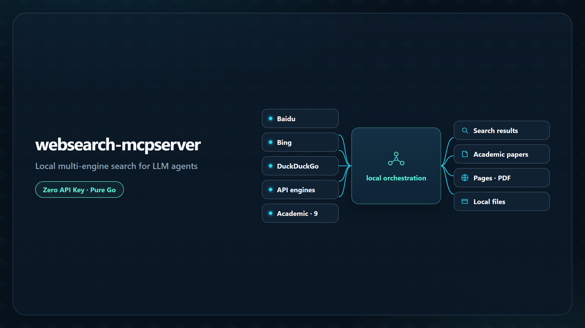
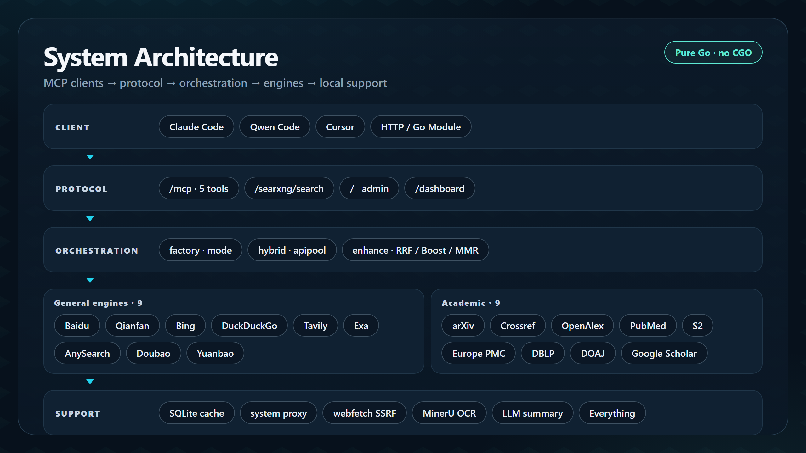
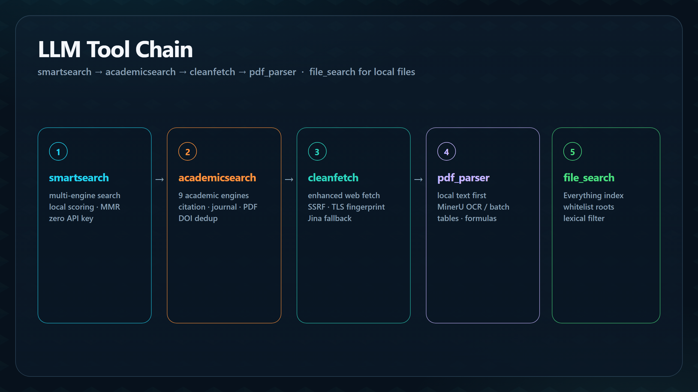
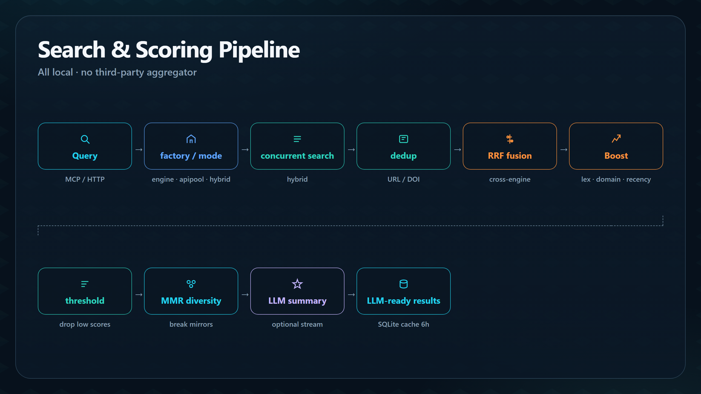
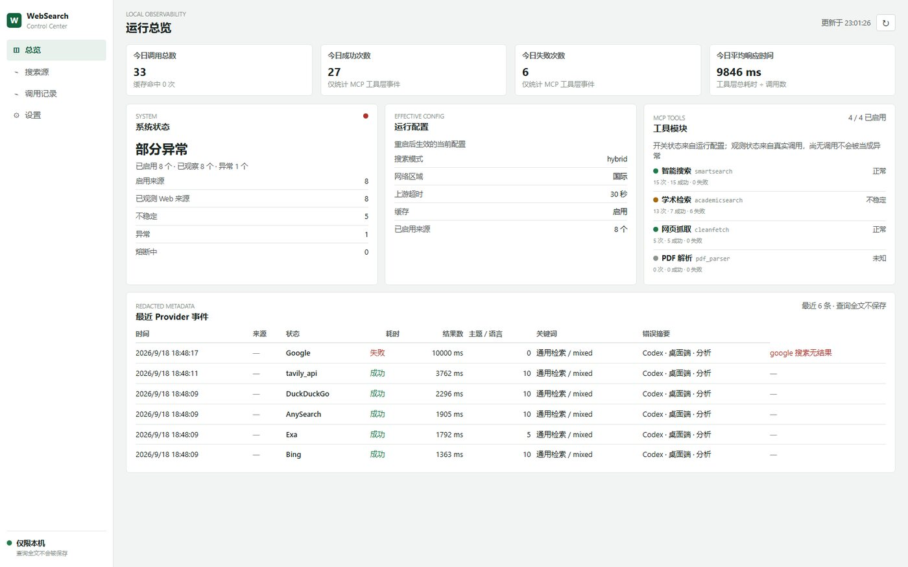

# websearch-mcpserver

> 轻量级 Web Search MCP Server — 零 API Key 即可运行

<p align="center">
  <a href="README.EN.md">English</a> · <a href="README.MD">中文</a>
</p>

<p align="center">
  <a href="https://go.dev/"></a>
  <a href="https://github.com/daidaiJ/websearch-mcpserver/releases"></a>
  
  
  <a href="LICENSE"></a>
</p>

<p align="center">
  
</p>

用 Go 编写的 MCP 搜索服务。内置百度网页、Bing、DuckDuckGo 等通用引擎、Parallel / AnySearch / Exa / Firecrawl 四个零 Key 托管 MCP 上游和 9 个学术引擎，搜索、评分、缓存全部在本地完成。可作为 MCP 工具接入 Claude Code、Qwen Code、Cursor，也可作为 Go 模块嵌入自有服务。

**免费、国内可用、结果可直接给 LLM 消费。** 无 Key 也能搜；有 Key 才用 Key。

---

## 架构一览

分层设计：客户端最多面对 5 个 MCP 工具；引擎组由 `mode` 组装；评分、缓存、代理、抓取都在本进程内完成，查询不会经过第三方聚合服务。

<p align="center">
  
</p>

| 层 | 做什么 |
|----|--------|
| **接入** | Claude Code / Qwen Code / Cursor / HTTP API / 嵌入 Go 模块 |
| **协议** | `/mcp` 最多五个工具 · `/searxng/search` 兼容 LiteLLM · `/__admin` 进程管理 · `/dashboard` 可选本机控制台 · `/metrics` Prometheus 观测 |
| **编排** | `factory` / `mode` 组装 · `hybrid` / `apipool` / `mcphub` · `enhance`（RRF / Boost / MMR） |
| **引擎** | 通用：百度网页 / 千帆 / Bing / DDG / Tavily / Exa / AnySearch / 豆包 / 元宝 / TinyFish / Keenable + 4 个托管 MCP 上游；学术 9 源并行 |
| **支撑** | SQLite 缓存、系统代理自动检测、webfetch（SSRF 防护）、MinerU、LLM 流式摘要、Everything |

更完整的回退链、代理检测与嵌入方式见 [docs/architecture.md](docs/architecture.md)。

---

## 面向 LLM 的工具链

五个检索工具互相衔接；已保存的长搜索、网页/PDF 正文通过 `cleanfetch` 分段读回，无需客户端访问容器文件。读取从 `offset=0` 开始，按 `next_offset` 续读到 `eof=true`。

<p align="center">
  
</p>

---

## 核心特性

| 能力 | 说明 |
|------|------|
| 零 Key 搜索 | 推荐 `mcphub`：Parallel / AnySearch / Exa / Firecrawl 托管 MCP 级联，失败冷却后切换，无需 API Key；`engine` 模式则走百度网页 + Bing 等本地引擎 |
| 多引擎融合 | 多种搜索模式、9 个通用引擎 + 4 个托管 MCP 上游 + 9 个学术引擎，主引擎失败自动回退 |
| 相关性评分 | RRF 融合排名 + 词汇对齐 / 域名品质 / 共识 / 权威 / 时效加分，低分自动裁剪；MMR 打散转载 / 镜像 |
| 响应透明 | 失败清单、日期与检索溯源；请求取消贯穿各引擎并带单引擎软超时；超限搜索保留候选预览，完整结果落盘后提供 `result_ref`，通过 `cleanfetch` 的引用读取模式分段读取 |
| 学术搜索 | 9 大学术引擎并行，按引用数 / 期刊权威 / PDF 可用性 / 新鲜度评分；DOI 跨引擎去重 |
| 网页抓取 | `cleanfetch` 内置 SSRF / DNS rebinding 防护与超大文件预检，失败回退 Jina Reader；可选 `fetch_mode` 复用托管 MCP 抓取 |
| PDF 解析 | 本地 PDF 文本优先提取，扫描件可回退 MinerU OCR；远程 MinerU 返回含图片 ZIP 地址；原文件超出单任务上限（默认 600 页）时本地 qpdf 裁切所选页，可配置自动分批与单次页数预算后分批上传；MinerU 等待可调，超时保留状态与任务引用，可续查原任务 |
| LLM 摘要 | 可选接入 OpenAI 兼容 API 生成结构化摘要，支持流式推送 |
| 系统代理 | Clash 等开启系统代理后，海外引擎 / Jina Reader 自动走代理 |
| 本地文件检索 | `file_search` 基于 Everything 索引毫秒级定位本地文件，目录白名单防越界，词汇对齐二次过滤防上下文爆炸（需 Everything HTTP Server） |
| 本机控制台 | 可选 `dashboard.enabled`，`/dashboard/` 只读观测界面：调用统计、来源健康、失败分类、白名单配置修改，以及 Prometheus 格式的 `GET /metrics`（默认关闭） |
| 轻量部署 | 单二进制、无 CGO、引用计数进程管理，可嵌入 Go 模块 |
| 中文 / 英文 | `language: auto|zh|en` 统一控制日志、MCP 工具描述与参数说明、控制中心界面；`auto` 按系统语言适配，控制中心另按浏览器语言每请求协商 |

---

## 搜索与评分管线

结果不是原始聚合。多引擎回传后在本地做去重、融合排名和多样性重排，再可选生成摘要：

<p align="center">
  
</p>

---

## 设计背景与目标

现成的 MCP 搜索方案各有短板：厂商服务（Tavily / Exa 等）要 Key、按量付费、数据过第三方、国内访问不稳；自建 SearXNG 要维护 Python 服务，结果是未优化的原始聚合。本项目把这些能力收回本地：单二进制自带多引擎融合、9 大学术源、抓取与 PDF 解析，让搜索成为 LLM 的**免费、国内可用、结果可直接消费**的基础能力。

完整的立项动机、与现成方案的逐维度对比、以及设计原则（本地优先隐私默认 / 零成本起步 / 丰简由人 / 解耦可组合 / 面向 LLM 的完整工具链 / 场景化优化）见 [docs/design.md](docs/design.md)。

---

## 快速开始

```bash
# 1. 下载二进制: https://github.com/daidaiJ/websearch-mcpserver/releases
# 2. 启动（无需手写配置，无需 API Key）
# Windows 开机自启动 可选
./websearch-mcpserver.exe install
#
#    首次 install 会在可执行文件目录自动生成一份可编辑的预设 config.yaml 和 autostart.vbs
./websearch-mcpserver start
# 或者点击
autostart.vbs
# 3. 注册到 MCP 客户端（见 docs/installation.md）
```

> 「零配置」= 首次启动自动生成与 `config.example.yaml` 相同的预设 `config.yaml`，改端口 / Key / 模式都改这一份文件。默认只监听 `127.0.0.1`；开放网卡（`host: 0.0.0.0`）时建议配置 `auth_token` 保护业务端点。
>
> 想用零 Key 托管 MCP 级联，把该文件的 `mode` 改为 `mcphub` 即可（`mcp_hub.enabled` 默认为开）。

或通过 MCP Hooks 实现会话自动启停（Qwen Code 示例，完整说明见 [docs/installation.md](docs/installation.md)）：

```json
{
  "hooks": {
    "SessionStart": [{ "matcher": "*", "hooks": [{ "type": "command", "command": "/path/to/websearch-mcpserver start", "timeout": 10000 }] }],
    "SessionEnd":   [{ "matcher": "*", "hooks": [{ "type": "command", "command": "/path/to/websearch-mcpserver stop",  "timeout": 10000 }] }]
  }
}
```

---

## 搜索模式速览

`mode` 一个字段决定引擎组合：**零 Key 推荐 `mcphub`**（托管 MCP 级联，失败冷却 + 本地引擎/Bing 降级）；**有 API Key 推荐 `apipool`**（多供应商 Key 池轮转，失败自动切换，网页引擎兜底）。`engine` 适合只依赖本地网页引擎、不需要 MCP 的场景；`baidu` / `tavily` / `exa` / `anysearch` / `doubao` / `yuanbao` 为单供应商直连（有 Key 才参与，主引擎失败自动回退）；`hybrid` 全引擎并发；`mcphub` 支持 `rotation_engines` 把本地引擎加入轮转、按代理可用性自动启用/跳过需代理上游。无 Key 时单供应商模式自动降级为 `engine`。

各模式的参与引擎、获取 Key 入口、`sk_list` 多 Key 轮询与逐引擎限流口径见 [docs/search.md](docs/search.md)。

`mcphub` 的四个内置 preset：

| preset | 默认需代理 | 特点 |
|--------|-----------|------|
| `parallel` | 否 | 直连可用，延迟最低 |
| `anysearch` | 否 | 国内直连友好，中文结果稳定 |
| `exa` | 是 | 匿名限流较低 |
| `firecrawl` | 是 | 匿名额度按出口 IP 分配 |

- 级联顺序默认 `parallel → anysearch → exa → firecrawl`，单次请求命中一个；失败冷却 60s 后切换，这是路由与降级，多家的结果不会合并返回。
- 全部失败后按 `fallback_engines`（默认 `bing → so360`，未启用的引擎自动跳过，so360 默认关闭）降级，最终仍由 `smartsearch` 回退 Bing。
- 每个上游可配 `api_key` / `sk_list`，留空走匿名档；鉴权失败自动换下一把 Key，连接/超时则冷却该 server 并级联；`exa` / `firecrawl` 仅在检测到代理时参与轮转，代理恢复后自动回归。
- `rotation_engines` 可把本地引擎（如 `so360`）加入主轮转，分摊匿名限流。
- `fetch_mode: off / fallback / prefer` 让 `cleanfetch` 复用同一批 MCP 抓取（`mode=mcphub` 时共用搜索 Hub 的冷却与 Key 池）；PDF 仍走本地解析，SSRF / HEAD 预检不跳过。

---

## 本机控制中心（可选，默认关闭）

`dashboard.enabled: true` 后，本机浏览器访问 `http://127.0.0.1:8338/dashboard/`。四个页面：总览 KPI 与客户端用量归组、搜索源健康与失败构成、请求级调用链（可筛选、可导出 CSV）、备份后写入白名单配置；全程被动观测，失败分类只报告，不干预调用。



启用即把 `dashboard.example.yaml` 复制为 `config.yaml` 同目录的 `dashboard.yaml`（首次 `start` / `install` 自动生成并**默认启用**，含随机本机管理员口令）；删除该文件并重启即完整回退，运行时零遥测开销。隐私默认：查询只存哈希 + 主题等脱敏元数据，密钥与查询原文永不落库、接口永不回显；默认仅本机 loopback 可读，写操作需 `admin_password`。另提供 `GET /metrics`（Prometheus/OpenMetrics 文本，只读、只含脱敏聚合），需 `dashboard.enabled: true`，未启用返回 503。

> 页面明细、全部配置键、快捷方式落位、安全模型与调用归属见 [docs/dashboard.md](docs/dashboard.md)。

---

## 文档导航

> 各文档均为中文默认，同名 `.en.md` 为英文版。

| 读者 | 文档 | 内容 |
|------|------|------|
| 👤 人类用户 | [docs/HUMAN_GUIDE.md](docs/HUMAN_GUIDE.md) | 人类阅读版：文档导读、模式选择、调优路线、排障速查 |
| 🤖 AI Agent | [docs/AGENT_GUIDE.md](docs/AGENT_GUIDE.md) | 省 token 版：部署速查、工具参数速查、机器契约、错误速诊 |
| 📚 参考 | [docs/installation.md](docs/installation.md) | 安装部署（二进制 4 平台 / GHCR linux amd64+arm64 / 源码 / 客户端注册）、运维与排障 |
| 📚 参考 | [docs/configuration.md](docs/configuration.md) | 完整配置参考、环境变量覆盖、默认值速查 |
| 📚 参考 | [docs/search.md](docs/search.md) | 搜索模式详解、引擎对照、相关性评分、MCP 工具参数 |
| 📚 参考 | [docs/architecture.md](docs/architecture.md) | 架构设计、回退链、代理检测、缓存、Go 模块嵌入、web-researcher 扩展 |
| 📚 参考 | [docs/design.md](docs/design.md) | 设计背景与目标：立项动机、与现成方案对比、设计原则 |
| 📚 参考 | [docs/api.md](docs/api.md) | Go Module API 与 HTTP API（MCP / SearXNG / Admin 端点） |
| 📚 参考 | [docs/dashboard.md](docs/dashboard.md) | 本机控制中心：全部配置键、写操作安全模型、隐私边界 |
| 📚 参考 | [docs/developers.md](docs/developers.md) | 开发者指南：包结构、接口契约、工具调用链、改动落点 |
| 📚 参考 | [CHANGELOG.md](CHANGELOG.md) | 版本变更日志 |

## 相关项目

- [web-researcher](https://github.com/daidaiJ/web-researcher) — 配套 Qwen Code 扩展，将网络调研卸载到子智能体，保持主模型上下文干净（详见 [docs/architecture.md](docs/architecture.md)）
