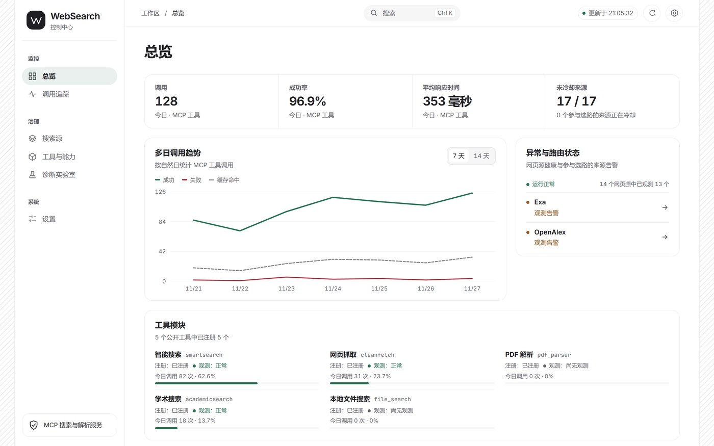

# Control Center (WebUI) Configuration Guide

English | [中文](dashboard.md)

This file is the **single complete configuration reference** for the control center (dashboard.yaml / WebUI): source management, tool runtime state, install behavior, access boundaries, security model, shortcuts, quota management, branding and data lifecycle. For everything else in config.yaml see [configuration.en.md](configuration.en.md). It describes configuration and operation, not a claim that any deployment is live or has passed acceptance.

---

## Guidance for AI agents (read before touching config)

If you are an AI agent helping a human enable, adjust or debug the control center, **confirm each item with the human first** — never make security decisions on their behalf:

| Item | Question to ask | Default |
|---|---|---|
| Enable or not | "Do you want the local control-center WebUI enabled?" | Enabled for fresh deployments |
| Access scope | "Local machine only, or should other devices on the LAN see it? Which CIDRs if so?" | Loopback only |
| Operation sources | "Do non-loopback clients need to run operations? What source IP does the server see from the Docker host?" | `write_allowed_networks: []`; read access does not grant operation permissions |
| Admin password | "Settings, keys, restart, and quota resets or adjustments require an admin password — do you want to set one, or should I generate a random one?" | Random, generated by the preset |
| Admin username | "Do you want an optional admin_username? When set, authenticated operations require the username too" | Not set (password-only) |
| Shortcuts | "Create shortcuts on the desktop / Start menu?" | desktop |
| Telemetry retention | "Is 30 days of call detail OK, or shorter/longer?" | 30 days |
| Quotas | "Auto-reset usage per period? Caps per provider?" | monthly, 1000 calls |

Red lines (no confirmation needed, always obey): **never write admin_password anywhere echoable outside dashboard.yaml; the WebUI can never read or change the password; opening non-local network access requires explicit human consent.**

---

## Quick start

```bash
# Fresh deployment: first start/install auto-generates dashboard.yaml (enabled + random password)
./websearch-mcpserver start

# Existing deployment: place the config manually
cp dashboard.example.yaml dashboard.yaml   # next to config.yaml, edit as needed
./websearch-mcpserver open                 # start server + open the console
```

- Console URL: `http://127.0.0.1:8338/dashboard/` (main server port)
- Disable: set `enabled: false` in dashboard.yaml or delete the file → restart; zero telemetry overhead
- Disabling the control center does not undo source/settings edits already saved to config.yaml; restore those through the configuration-backup flow rather than deleting data

## Console pages



| Page | What it shows |
|------|---------------|
| **Overview** | Tool-call KPIs, daily success / failure / cache-hit trend, service runtime, six public MCP tools and client usage |
| **Sources** | Enable switches, routing conditions, observed health, last 20 results, failure breakdown, success rate, average / P95 latency, API quotas and routing cooldowns |
| **Tools & capabilities** | Module settings for search ranking, fetching, PDF parsing, academic search, history, LLM summaries and Everything file search |
| **Usage** | Filter by status, tool, provider, error kind, application, project and cache state. Expand a call to see its provider attempts or export the current list to CSV. |
| **Settings** | Writes whitelisted config (mode, timeouts, thresholds, suspension durations, etc.) after backing up the current YAML; secrets are never echoed; theme and advanced actions live in the "Appearance & maintenance" card |

Behavior boundaries:

- **Passive observation**: records redacted metadata from real MCP calls. Tool configuration, registration and observation states are shown independently.
- **Failure classes + confidence**: failures are classified as rate limit / captcha / access denied / timeout / network / parse / no result; fewer than 5 samples is flagged "insufficient samples", and only 3 consecutive failures show suspension — **reporting only, calls are never skipped**.
- **Request-level correlation**: one tool call and the source events it triggered share a request id, answering "who supplied this result, who failed".

## Config files and precedence

| Layer | Notes |
|---|---|
| `dashboard:` block in main config.yaml | Optional; absent in old configs = control center off |
| `dashboard.yaml` (separate file) | Recommended single entry point: overrides the main dashboard block field-by-field |
| Env `WEBSEARCH_DASHBOARD_CONFIG` | Alternative path for dashboard.yaml |

- A broken file is warned about and ignored; the main service is unaffected
- Precedence: dashboard.yaml > main config dashboard block > built-in defaults

## Full configuration reference (dashboard.yaml)

```yaml
dashboard:
  enabled: true                 # master switch; false = console + telemetry off (zero cost)
  shortcut: desktop             # shortcut placement (Windows): desktop / start / both / off
  storage_path: "./data/dashboard.db"      # telemetry SQLite database
  retention_days: 30            # call-detail retention; daily aggregates kept long-term
  max_open_conns: 1             # telemetry SQLite pool cap (default 1, hard ceiling 32)
  secrets_path: "./data/dashboard-secrets.json"  # private key overlay (never echoed)
  config_path: ""               # path of dashboard.yaml itself; empty = next to config.yaml

  # —— independent read/write boundaries ——
  allowed_networks: []          # CIDR/bare-IP allowlist; empty = loopback only
  write_allowed_networks: []    # independent allowlist for runtime and authenticated operations
  # Any invalid entry makes that entire allowlist loopback-only (fail-closed).
  # Docker exceptions allow only the server-observed gateway address as /32; see Security model.

  # —— admin password (configuration and ledger access) ——
  admin_password: ""            # plaintext; or use the SHA-256 form below, one of the two
  admin_password_sha256: ""     # lowercase hex of sha256(plaintext)
  admin_username: ""            # optional; when set, authenticated operations also require a
                                # matching X-Admin-User header; unset = password-only
                                # (same behavior as upstream)
  # The password lives only in dashboard.yaml; the WebUI can never read or change it.
  # Without a configured password, only authenticated operations are disabled.

  # —— suspension display (report-only, never skips calls) ——
  suspension:
    ban_time_on_fail: "5s"
    max_ban_time_on_fail: "24h"

  # —— quota management ——
  quotas:
    enforce_providers: []        # disabled for all providers by default
    reset: monthly              # monthly / weekly / daily / none (manual only)
    reset_day: 1                # day of month for monthly resets (1-28)
    limits:                     # per-provider PER-KEY caps (calls/period); shown cap auto-multiplies by key count
      tavily: 1000
      exa: 1000
      anysearch: 1000
      doubao: 1000
      yuanbao: 2000             # matches the monthly free tier; enforcement uses yuanbao.monthly_limit

  # —— branding & presentation ——
  brand:
    title: ""                   # sidebar/tab title; empty = "WebSearch 控制中心"
    logo: ""                    # http(s) URL or local image path; empty = built-in W+magnifier
    theme: ""                   # green (default) / blue / mono
    accent: ""                  # custom accent #RRGGBB, overrides the theme preset
    icon: ""                    # custom shortcut icon (.ico path); empty = theme icon
    footer: true                # sidebar "about" intro with the GitHub link; false hides it
```

### Key-by-key notes

| Key | Type | Default | Meaning |
|---|---|---|---|
| `enabled` | bool | `false` (main config) / `true` (preset) | Master switch. Off = no telemetry, no routes, zero overhead |
| `shortcut` | string | `desktop` | Shortcut placement, see below |
| `storage_path` | path | `./data/dashboard.db` | Telemetry DB; relative to the config directory |
| `retention_days` | int | `30` | Detail retention (cleanup runs every 6h); daily aggregates unaffected |
| `max_open_conns` | int | `1` | Telemetry SQLite pool cap; 0/negative uses the default, hard ceiling 32. Each connection keeps its own page cache (SQLite default 2 MB) |
| `client_projects` | map<string,string> | `{}` | Explicit exact-client-name to project-label mapping for calls without a project header |
| `secrets_path` | path | `./data/dashboard-secrets.json` | Private credential overlay. APIs expose counts, sources and slot metadata |
| `config_path` | path | empty | Custom location of dashboard.yaml (env var also works) |
| `allowed_networks` | []string | `[]` | Read-only allowlist; fail-closed |
| `write_allowed_networks` | []string | `[]` | Independent allowlist for runtime and authenticated operations; empty/invalid = loopback only; read access grants no operation permissions; explicit overlay `[]` revokes the main-config write allowlist |
| `admin_password` | string | empty | Admin password (plaintext form) |
| `admin_password_sha256` | string | empty | Admin password (SHA-256 form, preferred) |
| `admin_username` | string | empty | Optional admin username; when set, authenticated operations must carry a matching `X-Admin-User` header (constant-time compare); unset = no username check. Lives only in dashboard.yaml like the password; never readable/editable via the WebUI |
| `suspension.*` | see left | `5s` / `24h` | Suspension display thresholds; unrelated to search behavior |
| `quotas.reset` | enum | `monthly` | Auto-reset period; `none` = manual only |
| `quotas.reset_day` | int | `1` | Day of month for monthly resets (1-28) |
| `quotas.limits` | map | per-key 1000 | provider → per-key cap (calls/period), auto-multiplied by key count; display-only by default, enforced for listed providers |
| `quotas.enforce_providers` | []string | `[]` | Enforce limits on selected direct keyed search providers |
| `brand.title` | string | built-in | Console title (also the browser tab) |
| `brand.logo` | string | built-in | URLs used as-is; local paths served via `/__admin/api/brand/logo` (same boundary) |
| `brand.theme` | enum | `green` | `green` / `blue` / `mono`; also picks the shortcut icon color |
| `brand.accent` | color | empty | `#RGB`/`#RRGGBB`; overrides the theme accent |
| `brand.icon` | path | empty | Custom .ico; lightweight per-boot check, rebuilt on change |
| `brand.footer` | bool | `true` | Sidebar "about" intro (GitHub link); `false` hides the block |

## Quota management (`quotas`)

Current behavior:

- **Local counting**: counts successful provider calls from telemetry for the current period. Search Sources → API Providers and Settings → Quota Management both show used, limit and remaining values with progress bars. Usage is marked near the limit at 80% and at the limit from 100%.
- **User-set caps, auto-scaled by key count**: `quotas.limits` configures the **per-key** per-period cap (calls) per provider; unset providers default to 1000. The shown cap = per-key cap × configured key count (aligned with how apipool's real consumption scales with available keys — no manual math). Only opted-in providers use this cap to block a search
- **Automatic period reset**: `monthly` / `weekly` / `daily` / `none` (`reset_day` picks the day of month); entering a new period zeroes usage automatically
- **Admin operations**: Reset and Adjust appear for local rows in Settings and require write authorization. Reset starts a new counting window and Adjust changes the displayed count while retaining the original call records.
- **Official Tavily / TinyFish usage**: both pages show the provider source and reset information. Tavily displays plan, key and related counters in credits. The reset time is displayed when the provider supplies it. TinyFish reports separate daily Search and Fetch (1,000/day) counts starting at 00:00 UTC. A failed Fetch lookup leaves the Search count visible with a warning. A failed official lookup is labeled and falls back to local counting when available. Official usage is prefetched at startup and cached for five minutes. It consumes no search credits.

The TinyFish search usage figure comes from its API. The displayed daily reference of 12,000 extrapolates the published hourly limit. TinySearch allows 30 requests per minute and 500 per hour. [TinyFish pricing](https://www.tinyfish.ai/pricing)

**Why other providers only have local counts (surveyed 2026-09)**: Exa / AnySearch / Bocha (Doubao search) / Baidu Qianfan / Yuanbao / Keenable offer no official endpoint that queries quota with the search API key — Exa's usage API needs a Service Key and only returns spend in USD; Bocha, Qianfan and Yuanbao usage APIs live behind their cloud-account signature schemes (not the search key). Check those providers' consoles for real quota; this project relies on user-set `quotas.limits` plus local real-call counting for comparison. Yuanbao additionally enforces `yuanbao.monthly_limit` before every request; a configured Dashboard hard limit also applies when opted in.

- **Optional routing hard limits**. Save and restart from Settings or add `enforce_providers: [exa, tavily]` in `dashboard.yaml`. Supported direct keyed web search providers are `anysearch`, `baidu`, `doubao`, `exa`, `keenable`, `tavily`, `tinyfish`, and `yuanbao`. The current search mode continues to any configured alternate source. The source table and request trace show the reason, independently of upstream attempt and failure counts.
- **What is counted**. The local cap scales by distinct key count and atomically reserves an allowance before a request. Failure before sending releases the allowance. Tavily uses the chosen key's official account and key limits alongside the local cap. When account identity across keys is ambiguous, recent or in-flight searches from this process are reserved conservatively. A single TinyFish key can use official search usage for the configured accounting window. Multiple TinyFish keys and failed official lookups use local accounting. Hosted MCP, anonymous requests, fetching, academic search, and other tools have separate accounting.
- **History and recovery**. Enabling an enforced provider for the first time imports same-period legacy successful observations and administrator adjustments. Legacy events for different routes may share the same name and overstate prior direct usage. Administrators can correct the local count. Subsequent direct sends use a dedicated durable counter. A reset, higher configured limit, or new period reopens an eligible route. Local reset leaves Tavily's official limits and Yuanbao's independent monthly cap in force. Other processes' usage remains subject to provider reporting latency.

## Request tracing

The sidebar has one call-history page, showing the latest 100 tool calls by default. Each call occupies one row; its disclosure button shows the request ID, redacted metadata and all retained provider attempts. Legacy records without a request ID are not linked by inference. Old #events links open call history.

Combine tool, provider, status, error-kind, application, project and cache filters. Status and cache are attributes of the tool call. Provider and error filters also match provider evidence within the request. Project matches the displayed label exactly, using the dashboard client-project mapping when the call did not record a label. CSV includes the same filtered tool calls and their complete retained provider details. Export stops if request details cannot be read.

`GET /__admin/api/calls` returns the latest 100 matching tool rows by default and accepts `tool`, `provider`, `status`, `error_kind`, `application`, `project`, `cache_hit=true|false` and `limit`. Use the canonical application ID, such as `codex`. The `/events` contract remains compatible. `GET /__admin/api/request-events?request_id=` returns retained events for the exact request ID. Both endpoints use the existing read guard and redacted field contract.

Recognized DBLP Anubis challenge pages are recorded as human-verification failures for both tool and provider, not ordinary empty searches. When no usable results remain and engines have failed, their individual reasons are retained. Historical parse-failure events are unchanged. Detection does not bypass upstream verification or automatically change source switches or actual cooldowns.

### External observability (Prometheus)

`GET /metrics` is served by the main service (independent of the dashboard access boundary) and always renders in-process metrics (in-flight HTTP requests, uptime, goroutines, heap allocation and `websearch_telemetry_enabled`); tool/provider request, success/failure, cache-hit counts and latency buckets are aggregated by in-process counters and scrapes do not read back SQLite, while the dashboard only persists the same privacy-preserving history. With the dashboard disabled (`dashboard.enabled: false`) the endpoint still returns 200 and business counters remain available; only `websearch_telemetry_enabled` drops to 0. It is read-only, accepts GET/HEAD only, and exposes no raw queries, URLs or secrets; the contract lives in [docs/api.en.md](api.en.md#observability-endpoint).

## Source management and saving

Choose the search mode in Settings. In API Pool mode, choose the providers, their order and the round-robin, priority or weighted strategy. MCPHub mode exposes its managed search chain, fallback order and timeouts. Open a provider row on the Sources page for settings specific to that provider, including the Yuanbao monthly limit and Doubao search options. Each change joins the same draft as edits made in Settings or Tools & capabilities.

Use Tools & capabilities to tune relevance and diversity, fetch limits, MinerU parsing, retention and summary generation. The host blocklist is passed to engines that support it. Native fetch proxy selection and proxying API providers have independent controls. For Everything, the console shows the resolved search scope to an authenticated administrator. Directory roots are read-only. The endpoint display excludes credentials and shows the server origin.

1. Source switches and common settings create a shared browser-memory draft only. Polling and tab changes do not immediately write configuration. Undo discards unsaved edits, not existing runtime configuration.
2. "Save and restart" previews and validates the change server-side, then shows before/after field differences for confirmation. The selected mode must retain at least one participating web source; enabled academic search must also retain an academic source. Validation does not count a source whose required proxy cannot be resolved as the last usable source, but does not probe proxy or upstream health. Invalid configuration, read-only access and locked fields cannot be written through confirmation.
3. Confirmation backs up each affected configuration file, updates only editable fields and checks the readback. Routing-related edits clear old search caches before requesting restart. Persistent cache generations and source-configuration fingerprints prevent old in-flight requests from restoring invalidated results, including across restart. The UI checks saved values against the restarted runtime values and reports effectiveness only when they agree. A successful save, a reachable API or the absence of errors alone is not proof of effectiveness.
4. An unconfirmed restart remains marked as such, with a retry control. When backups exist, "Restore backup and restart" is also available in the normal successful state. Restoration still previews differences and requires confirmation. The directories next to the dashboard database are `dashboard-backups/` for the main configuration and `dashboard-overlay-backups/` for the overlay. A change touching both creates two files named `settings-<timestamp>.yaml`. Keep the pair together. Restore uses the editable fields from the selected backup. Protect backup files as private configuration because they may contain credentials.

Save and restore requests carry the configuration-content `revision`. Another session or external edit changing the file after preview produces **HTTP 409**, without overwriting the new content. Refresh, compare and rebuild the draft before saving. The revision covers both files. Environment overrides lock the affected controls. With a dashboard overlay, edits to quota schedules and limits, alert windows, client project mappings, retention and brand defaults go to that overlay. The remaining search and tool settings go to the main configuration.

An empty brand title, accent or quota-limits map in the standalone file inherits the main configuration. The preview shows the inherited values. An explicit override in the standalone file takes precedence over the main configuration environment variable and remains editable. If you change the overlay or credentials file path manually, restart the service before editing settings.

The Credentials panel shows how many keys are effective and whether each comes from the environment, configuration or private overlay. For providers that support a pool, select a slot to update its label or remove it. Adding a slot preserves the rest of the pool. Review the operation and restart to apply pending changes. The panel reports the status of business endpoint authentication separately. WebUI administrators cannot edit the service authentication token.

Clearing a credential disables every slot for that item. Resetting the overlay restores the configuration and environment sources. Existing single-value overlay files are accepted. Private backups live in `dashboard-secrets-backups/` beside the overlay. An administrator may restore one there while the service is stopped.

## Runtime maintenance

Release one or all routing cooldowns from Sources. The normal rate limit still applies to subsequent requests. Refresh official usage to update the Tavily and TinyFish counters before the usual cache expires. Refreshes within 10 seconds of completion reuse that result.

The maintenance panel shows cache and history row counts alongside SQLite disk usage, including WAL and SHM files. Clearing rows makes database pages reusable, so the on-disk size may stay the same. Temporary-output cleanup acts on the service’s recognized top-level Markdown outputs. Expired and all-eligible cleanup are separate actions. Recent writes, archives, unrelated files and linked directories are excluded.

Diagnostics run only when an operator starts them. The proxy check opens a TCP connection to the configured endpoint. Rechecking Everything updates its connection status. Choose one configured source for a test search. A URL test reports the attempted chain, responding node and text length. The local fetcher validates each redirect. A remote fetch provider handles its own redirects. Confirm any metered services shown before starting. Diagnostics are excluded from usage history, while actual upstream calls can consume provider quota.

## Service runtime

Overview shows the binary version, uptime, stateless MCP mode and the MCP Resources switch. Proxy status shows the configuration mode, whether the endpoint resolves and whether API providers are configured to use it. LLM summary status includes the model and timeout. MCPHub shows its enable switch, remote-fetch policy and configured server order. The `/searxng/search` compatibility endpoint is shown as removed.

The trend chart uses daily tool-call aggregates from `/overview` for successes, failures and cache hits. The query covers the last 14 days, with gaps between observed dates plotted as zero. Cache hits are a separate series and can overlap with successful calls.

## Tools and observation boundaries

The catalog displays six public MCP tools. Configuration comes from the running process, registration from its MCP tool snapshot, and usage and health from observed tool events.

| Tool | Boundary |
|---|---|
| `smartsearch` | Available web/API routes in the configured mode; Bing is a source/fallback, not the tool master switch |
| `academicsearch` | Registered academic sources and the requested subset; disabled sources are also excluded from DOI/arXiv exact lookups |
| `cleanfetch` | Always registered; saved-body reads remain available, URL fetching has a separate `fetch_enabled` status. The switch does not gate smartsearch's `fetch_top_n`. Telemetry detail is `url_fetch` or `saved_result`, never references or body text |
| `pdf_parser` | PDF parsing; displays `max_pages` (default 20 pages when `pages` is omitted), `mineru_page_limit` (`GetMinerUPageLimit()` defaults to 600 pages), batch size, per-call page budget and OCR configuration, not proof that OCR ran |
| `file_search` | Read-only Everything filename/path indexing, not file-content reading; the existing lazy probe runs at MCP connection time, never because the dashboard is read |
| `search_history` | Shows the enable switch, registration, retention and observed calls. The tool registers when explicitly enabled and the local history store is available. |

`file_search` follows the configured `everything.roots` directory allowlist, `max_results` per page (default 10, hard cap 20), and `timeout_sec` (default 5 seconds). `everything.roots: []` means no directory allowlist restriction, shown as "目录未限制" (directories unrestricted); a nonempty list enforces the search scope. The control center does not edit roots. Use pagination rather than widening directory permissions. A configured URL does not prove the tool is callable: distinguish unprobed, pending registration, unavailable and registered states. Authentication material is never echoed.

PDF page progress is currently `not_collected`; the control center cannot derive real per-page progress, processed-page counts or budget consumption from it. Missing page-level information and upstream coverage must not be treated as complete telemetry. Parameters describe runtime configuration, not the outcome of a particular call.

The Sources page uses distinct badges for passive observation warnings and `actual_cooldown` routing cooldowns. A warning summarizes telemetry. A routing cooldown counts down to the registry expiry, with the expiration and error category in its tooltip. P95 uses the current health observation sample. Failure tags sum counts across observed aliases of the same source.

### Manual diagnostics

Diagnostics in Tools and Capabilities run on demand and display their results immediately. The proxy check makes one TCP connection to the effective endpoint. The `file_search` card can probe the configured Everything HTTP Server for connectivity, authentication, and response format. Once Everything becomes reachable, connected MCP clients can discover the newly registered `file_search` tool.

A search trial queries one configured web, API, hosted MCP, or academic source at most once. The PubMed trial uses ESearch to return PMIDs and article links. Open an article link to see its title and abstract. The console warns when a search trial may consume provider quota and requires confirmation before it runs. It displays elapsed time, result count, at most three title previews, and the failure category. A fetch trial follows the configured route order and calls each available node at most once. When the route includes remote services, the console lists services that may consume quota and requires confirmation. The trial can use quota from multiple services. The result shows the serving node, body status, character count, and elapsed time.

For fetch trials, the service validates public IP addresses, pins the destination when connecting locally, and checks each redirect it follows. Remote services resolve targets and follow their own redirects. Local trials use webfetch content extraction with a 2 MiB response limit and accept HTTP(S) URLs. Diagnostics stay out of call and health statistics and leave operational routing cooldowns unchanged.

## Shortcut placement (`shortcut`)

| Value | Behavior |
|---|---|
| `desktop` (default) | Creates `WebSearchMCP.lnk` on the desktop; double-click = start server + open console (lazy start) |
| `start` | Creates the shortcut under Start Menu "Programs": searchable from the Start screen, pinnable manually. Programmatic pin-to-Start is unreliable on Win10/11, so the Start Menu entry is the supported path |
| `both` | Desktop + Start menu |
| `off` | No shortcuts created; known desktop/Start-menu shortcuts are removed. `dashboard.enabled: false` behaves the same |

Details:

- Windows only; `start`, `open` and `install` share one idempotent sync routine
- The desired state is derived from the current executable path (target, `open` argument, executable directory) plus `brand.theme` / `brand.icon`. Each `.lnk` is read and its target, arguments, working directory, icon path and icon index are checked; any mismatch (manual edit, renamed or moved executable, theme/icon change, placement change) is rewritten
- A correct shortcut is only read and reported `unchanged`; missing ones report `created`, broken/changed ones `updated`, and `off` cleanup `removed`
- Icon file names carry a content hash (`websearch-<theme|custom>-<hash8>.ico`), so theme or icon-content changes produce a new file name and bypass the Windows icon cache
- Changing `shortcut` removes locations that are no longer needed (no dead links); the legacy `websearch-shortcut.theme` marker is removed automatically
- `uninstall` always cleans every known location (desktop + Start menu + startup folder)

## Security model

| Operation | Boundary |
|---|---|
| Read (pages + read-only APIs) | Always available on loopback; allowlisted networks are read-only |
| Password-free runtime operations | Release one or all routing cooldowns, refresh official Tavily / TinyFish usage, clear the search cache, clear search history, clean expired or all eligible temporary fetch files, recheck Everything, check proxy connectivity, test one search source, and test one fetch URL. Direct calls to these POST endpoints require only the operation source check. Loopback-only by default, with explicit peers allowed by `write_allowed_networks`. |
| Authenticated administration | Save settings, restore backups, manage keys, restart, reset or adjust quota, and view the full Everything index scope. Requests must pass both the page/API access gate and the operation source check. Send a correct `X-Admin-Password` and a matching `X-Admin-User` when configured. The server compares credentials in constant time. |
| Admin password | Lives only in dashboard.yaml; never returned by any API, never editable via the WebUI |
| No password configured | Authenticated operations are disabled. Eligible clients can still use runtime operations. |
| Query privacy | Telemetry stores sanitized metadata only (hash/topic/language/keywords/timing); full queries and URLs are never persisted |

The connection peer determines the source for both operation types. Forwarding headers are ignored. A peer on the operation allowlist alone can call the nine password-free POST endpoints directly. Opening the console and calling other read endpoints require read access. Using the console in a browser requires both allowlists. Password-free endpoints reject cross-origin browser requests. Native requests without an `Origin` header are still checked against `RemoteAddr`. An invalid entry makes its entire allowlist fall back to loopback. Edit allowlists and admin authentication in the configuration file.

**Docker**: keep the host port fixed to loopback, for example `-p 127.0.0.1:8338:8338`. Host-browser connections may appear as a bridge gateway inside the container. Use the source IP actually observed by the server, not the `docker inspect` gateway value alone. To permit host operations, add only that observed single address as `/32` to both allowlists. Configure an admin password for authenticated operations. The following address is illustrative and must not be copied without verification:

```yaml
dashboard:
  allowed_networks: ["172.17.0.1/32"]
  write_allowed_networks: ["172.17.0.1/32"]
  admin_password: "replace-with-a-private-admin-password"
```

Keep `write_allowed_networks: []` until the source is verified. Volume mappings (`dashboard.yaml`, `data/`) are in [installation.en.md#docker](installation.en.md#docker).

## Data and lifecycle

- Details are cleaned on a rolling `retention_days` window every 6 hours; daily aggregates stay (tiny)
- The DB migrates automatically (quota_state / client columns included); old databases upgrade with zero action, and downgrades ignore new tables/columns
- Removing the control-center configuration does not undo saved source settings. Restore and verify the main configuration through the backup flow first, then stop/remove control-center configuration or shortcuts as needed. Back up the database and private overlays; do not delete them to undo source settings

## Search-call usage

The overview groups all retained tool calls by application or project, with application and rolling 1/7/30-day filters. Known Codex/WorkBuddy aliases are combined for display; script calls are included in project usage too. Collapsed call rows show application and project; details retain the raw client name and CSV includes attribution. SDK per-call standard clientInfo takes precedence over session initialization identity, across HTTP and stdio; User-Agent is a fallback. A generic `websearch` identity alone cannot identify its host.

The known application list references [Token Monitor's tool list](https://github.com/Javis603/token-monitor#supported-tools), covering DeepSeek Harness (`dsh-mcp-client`), OpenCode, OpenClaw, Hermes Agent, Antigravity, Amp, Factory Droid, Kimi, GitHub Copilot, Pi, Oh My Pi, Kilo Code, Command Code, MiMo Code, Muse Code, ZCode, Kiro, CodeBuddy, Proma, CatPaw, Qoder, Reasonix, LM Studio, Unsloth Studio, Devin, MiniMax Code, and Goose. Existing Codex/WorkBuddy groups remain unchanged. Clients must report a matching application name or known alias. All calls follow the same grouping rules regardless of testing, acceptance or diagnostic purposes, with no purpose-based exclusions. Generic clients and model providers do not establish a host. Retained historical calls are grouped at query time without rewriting raw records.

HTTP clients reporting only a generic name can send a verified short application label, such as `X-WebSearch-Client: workbuddy`. A valid explicit label takes precedence over protocol identity. It accepts at most 32 letters/digits/spaces/`._-`, rejecting paths, URLs, control characters and `.` / `..`. Unrecognized hosts remain unidentified. These self-reported labels are for statistics, not authentication or authorization.

Project attribution uses a valid per-call `project` argument first, then the existing `X-WebSearch-Project` header. Missing/invalid labels may use confirmed exact `dashboard.client_projects` mappings; other calls stay unlabeled. Labels accept up to 64 letters, digits, spaces and `._-`, including Chinese; paths, URLs, control characters and `.` / `..` are not labels. They are self-reported statistics, never authorization or search scope.

The bundled [WebSearch skill](../skills/websearch-mcp/SKILL.md) passes a non-sensitive nickname only when the current project is explicit. No per-project client setup or log scanning is required. Skill bypass or missing context may leave calls untagged; there is no claim of universal automatic recognition. Project information is per-call, never inherited from initialize or another request. Conversation identifiers are not collected, missing labels are not evidence of standalone conversations, and history is not guessed or rewritten. See [skill setup](installation.en.md#skill--applicationproject-attribution).

These are search-call counts, not model tokens, monetary spend or remaining account quota. Provider quotas remain in the separate provider quota panel. The requested window is capped by detail retention, reported as `window_days`; incomplete all-time totals are not presented. `GET /__admin/api/clients?days=1|7|30` preserves `clients` and adds `usage` grouped by raw client, project and MCP tool. Provider fan-out is not counted as extra client calls.

## Interface language

The console has no language setting of its own: the language comes from the main config `language` (`auto` / `zh` / `en`) combined with the browser request header.

- **Negotiated per request**: both the console page and the `/__admin/api/*` responses follow the browser's `Accept-Language`; a satisfiable browser language wins, otherwise the resolved `language` value is used (`auto` resolves to the system language and falls back to `en` when neither Chinese nor English matches).
- **Correct on the first frame**: the server rewrites `<html lang>` to the negotiated language and inlines that language's UI strings into the page, so there is no flash of Chinese before a switch.
- **Single source of truth**: UI strings live in `pkg/i18n/locales/web.<lang>.json` and share the same catalog mechanism as logs and MCP descriptions (see the i18n section in [developers.md](developers.en.md)).
- **To force Chinese**: set `language: zh` in the main config (a satisfiable browser language still wins; clear the browser's English preference to pin it completely).

---

## Environment variables

| Variable | Purpose |
|---|---|
| `WEBSEARCH_DASHBOARD_CONFIG` | Path to dashboard.yaml (takes precedence over config_path) |
|---|---|
| `WEBSEARCH_DASHBOARD_CONFIG` | Path to dashboard.yaml (takes precedence over config_path) |
