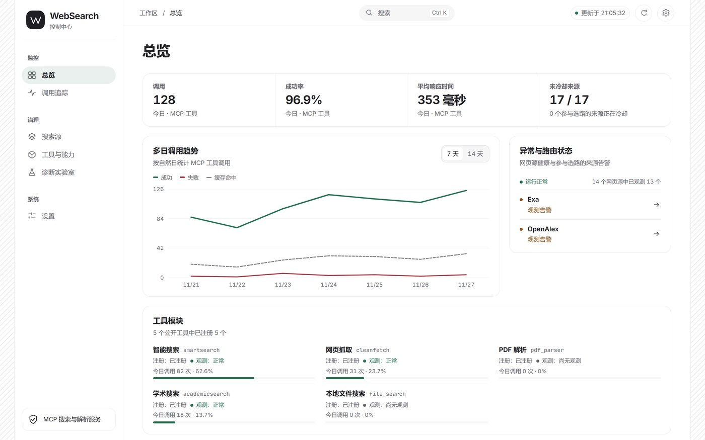

# 控制中心（WebUI）配置指南

[English](dashboard.en.md) | 中文

本文件是控制中心（dashboard.yaml / WebUI）的**唯一完整配置参考**，覆盖源管理、工具运行态、安装行为、访问边界、安全模型、快捷方式、额度管理、品牌呈现与数据生命周期。主配置（config.yaml）的其它项见 [configuration.md](configuration.md)。本文说明配置与操作机制，不代表某个部署已经上线或完成验收。

## 控制中心入口与离线构建

打开 `/dashboard/`。总览优先展示调用量与趋势。调用追踪、搜索源、工具与能力、诊断实验室和设置各有独立入口。按 Ctrl / ⌘ + K 可跳转到页面、搜索源或设置项。设置分为搜索路由、凭证与 Key 池、额度账本、本地存储、服务与外观。普通配置先进入草稿，预览字段差异并确认后才写入。重启核验会对照磁盘与运行值，备份恢复入口在服务子页。

界面源码位于 `frontend/src/`。在 `frontend/` 依次运行 `npm ci`、`npm test`、`npm run build`，提交源码及 `pkg/dashboard/web/dist/`。从仓库根目录运行 `go test ./pkg/i18n/` 和 `go test -short ./...`。Go 二进制直接嵌入已构建页面、脚本、样式和 WOFF2 字体，可以离线启动。

不想改内置前端时，可以把自建静态页面放到任意目录，用 `dashboard.ui.dir` 指向它；重启后 `/dashboard/` 整体改用外挂页面，内置 React 页面不再参与路由。外挂页面通过同源 `/__admin/api/` 使用控制中心数据，接口、权限与最小示例见 [dashboard-api.md](dashboard-api.md)。

替换来自配置或环境变量的多 Key 槽位时，私有凭证覆盖文件会记录其原始位置。此后如需回退旧版二进制，请同时从受保护的备份恢复替换前的凭证覆盖文件，旧版解析器只接受其已知字段。

---

## 给 AI Agent 的指引（修改配置前必读）

如果你是 AI agent 在帮人类启用、调整或排障控制中心，**动手前先逐项向人类确认**，不要替人做安全决策：

| 确认项 | 要问的问题 | 默认 |
|---|---|---|
| 是否启用 | 「要开启本机控制中心 WebUI 吗？」 | 全新部署默认启用 |
| 访问范围 | 「只在本机用，还是局域网内其它设备也要看？」「如果放行网段，是哪些 CIDR？」 | 仅本机 loopback |
| 操作来源 | 「是否需要允许非 loopback 来源执行操作？Docker 宿主请求在服务端实测是什么 IP？」 | `write_allowed_networks: []`；读白名单不授予操作权限 |
| 管理员口令 | 「改设置、密钥、重启及修改额度账本需要管理员口令，你想自己设置一个，还是让我生成随机的？」 | 预设文件随机生成 |
| 管理员用户名 | 「要不要配置可选的 admin_username？配置后验密操作需要同时提供用户名」 | 不配置（只验证口令） |
| 快捷方式 | 「要在桌面 / 开始菜单创建快捷方式吗？」 | desktop（桌面） |
| 遥测保留 | 「调用明细保留 30 天可以吗？想更短/更长吗？」 | 30 天 |
| 额度管理 | 「需要按周期自动重置用量吗？各供应商上限设多少？」 | monthly，默认 1000 次 |

红线（无需确认、直接遵守）：**管理员口令只在 dashboard.yaml 管理，不写入任何回显内容；WebUI 永远无法读取或修改口令；放行非本机读/写来源必须人类明确同意。**

---

## 快速开始

```bash
# 全新部署：首次 start/install 自动生成 dashboard.yaml（默认启用 + 随机口令）
./websearch-mcpserver start

# 已有部署：手动放置配置
cp dashboard.example.yaml dashboard.yaml   # 放在 config.yaml 同目录，按需修改
./websearch-mcpserver open                 # 拉起服务并打开控制台
```

- 控制台地址：`http://127.0.0.1:8338/dashboard/`（主服务端口）
- 关闭：`dashboard.yaml` 改 `enabled: false` 或直接删除该文件 → 重启，运行时零遥测开销
- 关闭控制中心不会撤销 WebUI 已保存至主 config.yaml 的源开关与设置；这些设置须按备份恢复流程回退，不要删除数据来替代配置回滚

## 控制台页面一览



| 页面 | 能看到什么 |
|------|------------|
| **总览** | 工具调用 KPI、成功／失败／缓存命中的多日趋势、服务运行状态、6 个公开 MCP 工具、客户端用量 |
| **搜索源** | 来源启用与参与条件、健康观测、最近 20 次结果、失败构成、成功率、平均／P95 延迟、API 额度及真实路由冷却 |
| **工具与能力** | 按模块调整搜索评分、网页抓取、PDF 解析、学术检索、搜索历史、LLM 摘要及 Everything 文件检索 |
| **诊断实验室** | 代理连通性、Everything 探测、单源试搜与单 URL 试抓，返回耗时、错误分类和抓取节点；可能消耗供应商额度，需确认 |
| **调用追踪** | 按状态、工具、来源、错误类型、应用、项目和缓存状态筛选；展开可看请求级来源链，按当前列表导出 CSV |
| **设置** | 备份当前 YAML 后写入白名单配置（模式、超时、阈值、熔断时长等），密钥永不回显；外观主题与高级操作合并为「外观与维护」卡片 |

行为边界：

- **被动观测**：记录真实 MCP 调用的脱敏元数据。工具配置、注册和观测状态独立显示。
- **失败分类 + 置信度**：失败归类为限流 / 验证码 / 访问被拒 / 超时 / 网络 / 解析 / 无结果；样本少于 5 次标记「样本不足」，连续 3 次失败才显示熔断，**只报告不干预调用**。
- **请求级调用链**：一次工具调用与其触发的来源事件共享 request id，回答「这次结果是谁给的、谁失败了」。

## 配置文件与加载顺序

| 层 | 说明 |
|---|---|
| 主 config.yaml 的 `dashboard:` 块 | 可选；老配置没有该块 = 控制中心关闭 |
| `dashboard.yaml`（独立配置） | 推荐唯一入口：按字段覆盖主配置的 dashboard 块 |
| 环境变量 `WEBSEARCH_DASHBOARD_CONFIG` | 指定 dashboard.yaml 的其它路径 |

- 文件损坏时警告并忽略，不影响主服务
- 优先级：dashboard.yaml > 主配置 dashboard 块 > 内置默认值

## 完整配置参考（dashboard.yaml）

```yaml
dashboard:
  enabled: true                 # 总开关；false = 控制台与遥测全部关闭（零开销）
  shortcut: desktop             # 快捷方式落位（Windows）：desktop / start / both / off
  storage_path: "./data/dashboard.db"      # 遥测 SQLite 数据库
  retention_days: 30            # 调用明细保留天数；每日汇总长期保留
  max_open_conns: 1             # 遥测库 SQLite 连接池上限（默认 1，上限 32）
  secrets_path: "./data/dashboard-secrets.json"  # API Key 私密覆盖文件（接口永不回显）
  config_path: ""               # dashboard.yaml 自身路径；空 = 主配置同目录
  ui:
    enabled: true               # false = 只保留 API，不挂载 /dashboard/ 页面
    dir: ""                     # 外挂前端目录（含 index.html）；空 = 内置 React 页面

  # —— 独立读/写访问边界 ——
  allowed_networks: []          # CIDR/裸 IP 白名单；空 = 仅本机 loopback
  write_allowed_networks: []    # 独立操作白名单；空 = 仅 loopback
  # 每份白名单任一条目非法 = 该份整体回退 loopback（fail-closed）。
  # Docker 例外只放行服务端实测网关单地址 /32，参见安全模型。

  # —— 管理员口令（配置与账本等管理操作）——
  admin_password: ""            # 明文；或用下面 SHA-256 形态，二选一
  admin_password_sha256: ""     # sha256(明文) 的小写十六进制
  admin_username: ""            # 可选；配置后验密请求还需携带匹配的 X-Admin-User，
                                # 未配置 = 只验证口令（与上游行为一致）
  # 口令与用户名只能在 dashboard.yaml 手改，WebUI 无法读取或修改；
  # 未配置口令时，只有需要验密的管理操作禁用。

  # —— 熔断展示（只报告，不干预调用）——
  suspension:
    ban_time_on_fail: "5s"
    max_ban_time_on_fail: "24h"

  # —— 额度管理 ——
  quotas:
    enforce_providers: []        # 默认全部关闭
    reset: monthly              # monthly / weekly / daily / none（仅手动重置）
    reset_day: 1                # monthly 的每月重置日（1-28）
    limits:                     # 每供应商单 Key 上限（次/周期）；多把 Key 时展示上限自动乘以 Key 数
      tavily: 1000
      exa: 1000
      anysearch: 1000
      doubao: 1000
      yuanbao: 2000             # 对齐每月免费额度；实际拦截以 yuanbao.monthly_limit 为准

  # —— 品牌与呈现 ——
  brand:
    title: ""                   # 侧栏/标签页标题；空 = "WebSearch 控制中心"
    logo: ""                    # http(s) URL 或本地图片路径；空 = 内置 W+放大镜
    theme: ""                   # green（默认，绿色办公）/ blue（蓝白科技）/ mono（黑白灰度·立体）
    accent: ""                  # 自定义主色 #RRGGBB，覆盖主题预设
    icon: ""                    # 自定义快捷方式图标（.ico 路径）；空 = 主题内置图标
    footer: true                # 侧边栏「关于」项目介绍；false = 隐藏
```

### 各键说明

| 键 | 类型 | 默认 | 说明 |
|---|---|---|---|
| `enabled` | bool | `false`（主配置）/ 预设 `true` | 总开关。关闭时无遥测、无路由、零开销 |
| `shortcut` | string | `desktop` | 快捷方式落位，详见下节 |
| `storage_path` | path | `./data/dashboard.db` | 遥测库；相对主配置目录 |
| `retention_days` | int | `30` | 明细滚动清理周期（每 6 小时执行）；日聚合不受影响 |
| `max_open_conns` | int | `1` | 遥测库 SQLite 连接池上限；0/负值取默认，上限 32。每连接自带一份页缓存（SQLite 默认 2 MB） |
| `client_projects` | map<string,string> | `{}` | 精确客户端名到项目简称的显式映射；仅用于缺少项目头时的统计归属 |
| `secrets_path` | path | `./data/dashboard-secrets.json` | 凭证覆盖文件；接口返回生效数量、来源及槽位备注 |
| `config_path` | path | 空 | dashboard.yaml 的自定义位置（也可用环境变量） |
| `ui.enabled` | bool | true | `false` 只保留 `/__admin/api/`，不挂载 `/dashboard/` 页面与静态资源；不会从二进制移除已嵌入资产，极限体积用 `go build -tags no_ui` |
| `ui.dir` | path | 空 | 外挂前端目录（必须含 `index.html`）；空 = 内置 React 页面。相对路径按主配置目录解析，目录无效时 `/dashboard/` 返回 500；切换目录需重启，目录内文件变更刷新即生效。接口见 [dashboard-api.md](dashboard-api.md) |
| `allowed_networks` | []string | `[]` | 只读放行网段；fail-closed |
| `write_allowed_networks` | []string | `[]` | 独立操作白名单，覆盖运行态与验密操作；空/非法 = 仅 loopback；读白名单不授予操作权限；overlay 显式 `[]` 可撤销主配置写白名单 |
| `admin_password` | string | 空 | 管理操作口令（明文形态） |
| `admin_password_sha256` | string | 空 | 管理操作口令（SHA-256 形态，更推荐） |
| `admin_username` | string | 空 | 可选管理员用户名；配置后验密请求必须携带匹配的 `X-Admin-User` 头（常量时间比较），未配置 = 不做用户名检查。与口令一样只住 dashboard.yaml，WebUI 无法读取或修改 |
| `suspension.*` | 见左 | `5s` / `24h` | 熔断阈值展示口径，与搜索行为无关 |
| `quotas.reset` | enum | `monthly` | 自动重置周期；`none` 表示只手动重置 |
| `quotas.reset_day` | int | `1` | monthly 的重置日（1-28） |
| `quotas.limits` | map | 单 Key 1000 | 供应商 → 单 Key 上限（次/周期）；多 Key 自动乘以 Key 数；默认仅展示，列入 `enforce_providers` 后在搜索路由执行 |
| `quotas.enforce_providers` | []string | `[]` | 对指定的直连有 Key 搜索源执行硬限 |

## 额度管理（`quotas`）

当前机制：

- **本地真实调用计数**：根据遥测统计本周期内供应商的成功调用。在「搜索源 → API 供应商」与「设置 → 额度管理」显示已用量、上限、剩余量及进度。达到上限的 80% 时提示接近上限，达到 100% 时标出已用尽。
- **上限由用户自设，按 Key 数自动换算**：`quotas.limits` 按供应商配置**单 Key** 每周期上限（次），未配置的用默认 1000；实际展示上限 = 单 Key 上限 × 已配置 Key 数（与 apipool 按可用 Key 数累加的实际消耗容量对齐，无需手工换算）；只有显式启用的供应商受路由硬限约束
- **自动周期重置**：`monthly` / `weekly` / `daily` / `none`（`reset_day` 定月内重置日），进入新周期自动归零
- **管理员手动操作**：设置页仅对本地计数行显示「重置」和「修正」，须经写权限校验。重置会从当前时间重新累计，修正值用于展示并保留原始调用记录。
- **Tavily / TinyFish 官方用量优先**：两个页面均显示官方来源及重置信息。Tavily 按 credits 显示套餐、Key 及相关细项，具体重置时间由供应商提供时才显示。TinyFish 以 00:00 UTC 为日界线，分别查询 Search 与 Fetch（1,000 次／天）。任一查询失败会标出失败项，并保留另一项的可用数字。官方搜索用量查询失败时，有本地统计则显示该回退值。官方读取会在服务启动后预热，并缓存 5 分钟，不消耗检索额度。

TinyFish 搜索的已用量来自用量接口。官方公布的速率为每分钟 30 次、每小时 500 次，面板的 12,000 是按 24 小时折算的日参考值。[TinyFish 官方定价](https://www.tinyfish.ai/pricing)

**为什么其他供应商只有本地计数（2026-09 实测调研）**：Exa / AnySearch / 博查（豆包搜索）/ 百度千帆 / 元宝 / Keenable 均未提供「用搜索 API Key 直查额度」的官方端点——Exa 的 usage 接口需要 Service Key 且只返回花费金额；博查、千帆与元宝的用量查询走各自云账号的签名体系（非搜索 Key）。这些供应商的额度请到各自控制台查看，本项目用 `quotas.limits` 自设上限 + 本地真实调用计数对照展示。元宝另由 `yuanbao.monthly_limit` 在发请求前硬拦截，控制台硬限若同时开启，两者都须满足。

- **按供应商开启硬限**：在设置中保存并重启，或在 `dashboard.yaml` 写入 `enforce_providers: [exa, tavily]`。支持 `anysearch`、`baidu`、`doubao`、`exa`、`keenable`、`tavily`、`tinyfish`、`yuanbao` 的直连有 Key 网页搜索。达到限制后跳过该路由，并沿用当前模式的回退。源表和调用链分别显示跳过原因，跳过不增加供应商的失败或尝试数。
- **额度口径**：本地硬限按去重后 Key 数乘配置上限，发请求前原子预留，发送前失败释放。Tavily 按所选 Key 查询官方账户及 Key 限额，两者与本地上限同时执行。多 Key 的官方账户归属无法核实时，对本进程已发或在途请求保守预留。单 Key 的 TinyFish 可以用统计周期内的官方搜索计数与配置上限比较，多 Key 或官方数据不可用时用本地账本。托管 MCP、匿名档、抓取、学术及其他工具各走独立额度。
- **历史及恢复**：首次启用会迁移当期的旧遥测成功数及人工修正。旧同名遥测曾混有其他入口，可能高估，可用额度修正核对。此后本地账本按实际直连发送计数，重置、调高上限或进入新周期都会重新判断。控制台重置不更改 Tavily 官方额度或元宝独立月度限额。外部进程及其他应用的消费依赖供应商报告，无法实时计入本地预留。

| `brand.title` | string | 内置 | 控制台标题（也用于浏览器标签页） |
| `brand.logo` | string | 内置 | URL 直接引用；本地路径经 `/__admin/api/brand/logo` 提供（同一访问边界） |
| `brand.theme` | enum | `green` | `green` / `blue` / `mono`；同时决定快捷方式图标配色 |
| `brand.accent` | color | 空 | `#RGB`/`#RRGGBB`；设置后覆盖主题主色 |
| `brand.icon` | path | 空 | 自定义 .ico；每次启动轻量检查，变化即重建快捷方式 |
| `brand.footer` | bool | `true` | 侧边栏底部「关于」项目介绍（GitHub 链接）；`false` 整块隐藏 |

## 调用追踪

侧栏仅保留调用记录，默认显示最近 100 次工具调用。每次调用一行，展开按钮显示请求编号、脱敏元数据及完整已保留的来源尝试；历史记录没有请求编号时不推测关联。原来的 #events 链接兼容转到调用记录。

工具、来源、状态、错误类型、应用、项目和缓存命中状态可以组合筛选。状态与缓存字段取自工具调用；来源和错误类型也匹配同一请求的来源证据。项目按当前展示的项目标签精确匹配，无记录标签时沿用控制中心的客户端项目映射。CSV 导出同一筛选结果和这些请求的完整已保留来源明细，读取失败时中止导出。

`GET /__admin/api/calls` 默认返回最近 100 条匹配的工具记录，接受 `tool`、`provider`、`status`、`error_kind`、`application`、`project`、`cache_hit=true|false` 和 `limit`。应用参数使用标准 ID，例如 `codex`。原 `/events` 接口保留兼容。`GET /__admin/api/request-events?request_id=` 按精确请求编号读取完整保留明细。两者均沿用读取授权和脱敏字段。

DBLP 返回已识别的 Anubis 挑战页时，工具和来源事件记为人机验证，不当作正常空检索。没有可用结果且存在引擎失败时，保留逐源原因；历史解析失败记录不会被重写。此识别不绕过上游验证，也不自动改变来源开关或实际冷却。

### 外部观测接入（Prometheus）

`GET /metrics` 由主服务提供（不依赖控制台访问边界），始终输出进程内指标（在飞 HTTP 请求、uptime、goroutine、堆分配与 `websearch_telemetry_enabled`）；工具/供应商请求数、成功失败、缓存命中与延迟分桶由进程内计数器聚合，抓取时不回读 SQLite，控制台仅持久化同口径的脱敏历史。控制台关闭（`dashboard.enabled: false`）时端点仍返回 200，业务计数照常输出，只把 `websearch_telemetry_enabled` 标 0。端点只读、只接受 GET/HEAD，不暴露查询原文、URL 或密钥；契约见 [docs/api.md](api.md#观测端点)。

## 源管理与保存

在「设置」选择搜索模式。使用 API 调度池时，可以选择供应商、排列次序，并设置轮询、优先级或加权策略。使用 MCPHub 时，可以调整托管检索链、后备源次序和超时。在「搜索源」展开单个供应商，可调整元宝月限、豆包检索选项等专属参数。这些编辑与「设置」「工具与能力」共用一份草稿。

「工具与能力」按任务组织参数，例如搜索相关度与结果多样性、抓取上限、MinerU 解析、历史保留与摘要生成。域名黑名单由支持该配置的引擎执行。原生抓取与 API 供应商分别控制是否使用代理。管理员可以按需查看 Everything 的服务地址与可检索目录。服务地址只展示来源站点，目录范围在此处只读。

1. 修改源开关或常用设置只生成浏览器内共享草稿；页面轮询和切换标签不会立即写配置。撤销只丢弃未保存草稿，不撤销已有运行配置。
2. 「保存并重启」先向服务端预览/校验，再显示字段的前后差异供确认。当前模式必须保留至少一个可参与网页源；学术工具开启时也须至少保留一个可参与学术源。校验不会把必需代理无法解析的源计为最后一个可用源，但不探测代理或上游服务的健康。配置错误、只读环境或锁定字段不会通过确认写入。
3. 确认后备份本次涉及的配置文件、精确修改可编辑字段并读回验证；影响源路由的变更会清理旧搜索缓存，随后请求重启。缓存通过持久化代际与源配置指纹防止旧在途请求重新写回已失效结果，重启后同样有效。界面核对磁盘已保存值与重启后的运行值，二者一致才显示「运行配置已确认生效」。仅保存成功、API暂时恢复或未出现错误都不足以说明生效。
4. 重启未确认时保留「未确认生效」状态并提供重试；备份列表非空时，正常成功状态也可使用「恢复备份并重启」，恢复前仍预览差异并确认。主配置备份保存在遥测数据库旁的 `dashboard-backups/`，独立控制中心配置备份在 `dashboard-overlay-backups/`。同一份草稿改动两个文件时，两处会各生成一份同名的 `settings-<时间>.yaml`，恢复时需要同时保留。恢复时只应用选定备份中的可编辑字段。备份文件可能含原配置凭证，须按私密文件保护。

保存及恢复都携带配置内容版本 `revision`。配置在预览后被其他会话或外部编辑改动时，服务端返回 **HTTP 409**，不覆盖新内容；刷新后重新比较/编写草稿再保存。该版本同时覆盖两个配置文件。受环境变量覆盖的字段会锁定。存在独立 dashboard.yaml 时，额度周期和上限、观测告警窗口、客户端项目映射、保留天数与品牌默认值写入该文件，搜索和工具参数写入主配置。

独立配置中留空的品牌标题、品牌主色和额度上限表会继承主配置，预览显示实际继承的值。独立文件显式提供某项时，以它覆盖主配置环境变量的值，控制台可以编辑这项。手动变更独立配置或凭证文件路径后，请先重启服务再编辑设置。

凭证面板列出实际生效的数量，以及凭证来自环境变量、配置还是私密覆盖文件。支持多 Key 的供应商可按槽位追加、删除或修改备注，追加会保留池内其余凭证。预览操作并保存，重启后核对生效状态。业务端点鉴权单独显示启用状态，服务鉴权令牌只能从控制台以外的配置入口修改。

「清空」会停用此项的全部槽位，「恢复配置来源」会重新采用配置文件和环境变量。已有单值覆盖文件可继续加载。凭证备份位于覆盖文件旁的 `dashboard-secrets-backups/`，管理员可在停服后从中恢复。

## 运行态维护

在「搜索源」可以解除指定源或全部来源的路由冷却，下一次请求仍遵守正常限速。额度面板可以一并刷新 Tavily 和 TinyFish 的官方用量，单源检视则只刷新选中的供应商。同一供应商刷新完成后的 10 秒内，重复操作复用该次结果。源详情可同时显示官方用量和服务本地统计，本地计数遵循独立的统计周期。

维护面板分别显示缓存与历史记录的条数，以及 SQLite 主文件、WAL 和 SHM 的磁盘占用。清空记录后，数据库会复用已释放的数据页，文件大小可能保持原值。临时文件清理只处理服务在顶层生成、可识别的 Markdown 输出，可选「仅过期」或「全部可清理」。刚写入的文件、持久归档、其他文件和链接目录均会保留。

人工诊断仅在操作员点击时执行。代理检查测试到已配置端点的 TCP 连接，Everything 重探会更新连接状态。试搜可选单个来源，试抓会报告尝试过的链路、命中节点和正文字符数。本机抓取会逐跳校验重定向，远端抓取服务自行处理其重定向。执行前请核对页面列出的可能计费服务。试跑结果独立展示，实际出网仍可能消耗供应商额度。

## 服务运行状态

总览显示二进制版本、运行时长、MCP 无状态模式及 MCP Resources 开关。代理显示配置方式和当前是否解析到端点，同时显示 API 供应商代理开关。LLM 摘要显示启用状态、模型与超时，MCPHub 显示总开关、远端抓取策略和按配置顺序列出的托管服务。上游已移除 `/searxng/search` 兼容端点，页面显示「已移除」。

多日趋势图使用 `/overview` 的工具事件日汇总，分别显示成功数、失败数与缓存命中数。统计窗口覆盖最近 14 天，已观测日期之间的空白日按零次绘制。缓存命中单独绘制，可与成功调用重叠。

## 工具与观测边界

工具清单展示六个公开 MCP 工具。配置开关来自当前运行配置，注册状态来自 MCP 工具快照，调用次数与健康状态来自真实工具事件。

| 工具 | 边界 |
|---|---|
| `smartsearch` | 当前模式的可用网页/API组合；Bing 是源与回退，不是工具总开关 |
| `academicsearch` | 已注册学术源及请求指定子集；关闭源也约束 DOI/arXiv 精确查询 |
| `cleanfetch` | 始终注册；已保存正文读取可用，URL 抓取独立展示开关（`fetch_enabled`）；开关不限制 smartsearch 的 `fetch_top_n`。遥测 detail 为 `url_fetch` 或 `saved_result`，不记录引用/正文 |
| `pdf_parser` | PDF 解析；展示 `max_pages`（省略 `pages` 时默认 20 页）、`mineru_page_limit`（`GetMinerUPageLimit()` 默认 600 页）、分批大小、单次页预算和 OCR 配置，不代表本次已执行 OCR |
| `file_search` | Everything 只读文件名/路径索引检索，不读取文件正文；接入 MCP 时按既有机制延迟探测，dashboard 读取不触发探测 |
| `search_history` | 展示开关、注册状态、保留天数与真实调用统计。只有显式启用且本地历史库就绪才注册。 |

`file_search` 的目录白名单 `everything.roots`、每页 `max_results`（默认 10、硬上限 20）和 `timeout_sec`（默认 5 秒）以实际配置为准。`everything.roots: []` 表示无目录白名单限制，界面显示「目录未限制」；非空列表才限制检索范围。控制中心不编辑 roots；页数多时用分页，不扩大目录权限。配置 URL 不等于工具已可调用，应区分尚未探测、等待注册、不可用与已注册；鉴权材料不回显。

PDF 页进度当前为 `not_collected`，控制中心不能据此展示真实逐页进度、已处理页数或预算消耗。未采集的页级信息和上游覆盖不应被当成完整遥测；参数展示只说明运行配置，不说明某次调用的结果。

搜索源用不同颜色区分基于遥测的「观测告警」和 `actual_cooldown` 的「路由冷却」。观测告警只展示历史结果。路由冷却按实际到期时间倒计时，悬停显示类型和截止时刻。P95 与当前健康观测使用同一批样本；失败构成标签汇总同一来源各运行别名的记录。

### 人工诊断

「工具与能力」中的人工诊断只在点击后执行，结果即时显示。代理检查会对当前解析到的端点做一次 TCP 连接。Everything 的手动重探位于 `file_search` 卡片，会直接验证当前 HTTP Server 的连通性、鉴权与响应格式。服务恢复后，已接入的 MCP 客户端可看到新注册的 `file_search`。

指定搜索源的试搜最多向单个源发起一次检索，支持已配置的网页、API、托管 MCP 和学术源。PubMed 试搜通过 ESearch 返回 PMID 和论文页链接，标题和摘要由用户打开论文页查看。试搜可能消耗付费或免费配额时，页面会提示，并要求确认后执行。界面只展示耗时、结果数、最多三条标题，以及分类错误。试抓会按运行配置的顺序尝试可用节点，每个节点最多调用一次。存在远端服务时，会列出可能消耗额度的服务，并要求确认后执行。抓取结果只展示实际节点、正文状态、字符数与耗时。

试抓复用本机公开 IP 校验并在出网连接时固定目标 IP。本机跟随跳转时逐跳检查，远端抓取服务自行解析目标和处理跳转。试抓使用 webfetch 正文提取器，响应限制为 2 MiB，URL 以 HTTP(S) 为限。诊断请求不写入日常调用记录与健康统计，不改变生产路由冷却。

## 快捷方式落位（`shortcut`）

| 值 | 行为 |
|---|---|
| `desktop`（默认） | 桌面创建 `WebSearchMCP.lnk`，双击 = 拉起服务 + 打开控制台（lazy 启动） |
| `start` | 开始菜单「Programs」创建同名快捷方式：开始屏幕可直接搜索到，也可手动「固定到开始屏幕」。程序化直接 pin 在 Win10/11 上不可靠，故以开始菜单条目为准 |
| `both` | 桌面 + 开始菜单 |
| `off` | 不创建快捷方式，并删除桌面/开始菜单中的已知快捷方式；`dashboard.enabled: false` 行为相同 |

细节：

- 仅 Windows 生效；`start`、`open`、`install` 共用同一同步逻辑，重复执行幂等
- 期望状态由当前 exe 路径（目标 + `open` 参数 + exe 目录）与 `brand.theme` / `brand.icon` 计算；逐个读取 `.lnk` 校验目标、参数、工作目录、图标路径与图标索引，任一不符（手工改坏、exe 重命名或换目录、主题/图标变化、落位变化）即重写
- 已正确的快捷方式只读取校验并报 `unchanged`；缺失报 `created`，被改坏或需要换图标/路径报 `updated`，`off` 清理报 `removed`
- 图标文件名含内容哈希（`websearch-<theme|custom>-<hash8>.ico`）：主题或图标文件内容变化会换新文件名并重建 `.lnk`，绕开 Windows 图标缓存
- 更换 `shortcut` 值会清理不再需要的位置，不留死链；旧版 `websearch-shortcut.theme` marker 自动移除
- `uninstall` 始终清理全部已知位置（桌面 + 开始菜单 + 开机自启目录）

## 安全模型

| 操作 | 边界 |
|---|---|
| 读取（页面 + 只读 API） | 本机 loopback 始终可用；`allowed_networks` 授权指定来源读取 |
| 免密运行态操作 | 解除单源或全部路由冷却、强刷 Tavily / TinyFish 官方额度、清搜索缓存、清空搜索历史、清理过期或全部合规临时抓取文件、手动重探 Everything、代理连通检查、单源试搜、单 URL 试抓。直接调用这些 POST 端点只需通过操作来源校验。默认仅 loopback，按 `write_allowed_networks` 的显式来源放行。 |
| 验密的管理操作 | 设置保存与备份恢复、密钥管理、重启、额度重置与修正、查看 Everything 完整索引范围。须同时通过页面/API 访问边界和操作来源校验，并携带正确的 `X-Admin-Password`，配置用户名时还须匹配 `X-Admin-User`。口令与用户名采用常量时间校验。 |
| 管理员口令 | 只存在于 dashboard.yaml；WebUI 与 API 永不返回，也无法修改 |
| 未配置口令 | 验密操作禁用，符合来源要求的运行态操作仍可用。 |
| 查询隐私 | 遥测只存脱敏元数据（哈希/主题/语言/关键词/耗时），完整查询与 URL 不落库 |

两类操作均按实际连接来源判断，不信任转发头。只在操作白名单中的来源可直接调用上述九个免密 POST 端点。打开控制中心及调用其它读取端点须通过读取边界。在浏览器内使用控制中心执行操作，应同时满足两份白名单要求。免密端点拒绝跨站浏览器请求。无 `Origin` 的原生调用仍按 `RemoteAddr` 校验。任一白名单条目非法时，该白名单整体回退 loopback。白名单与管理员认证只能在配置文件中修改。

**Docker 部署**：保持宿主端口固定发布到回环，例如 `-p 127.0.0.1:8338:8338`。宿主浏览器在容器内可能表现为 bridge 网关；以服务端实际看到的请求来源 IP 为准，不能只据 `docker inspect` 网关值认定来源。需要从宿主执行操作时，只将实测单地址 `/32` 同时加入读、操作两份白名单。验密的管理操作还需配置管理员口令。以下地址仅示意，未经实测不能照抄：

```yaml
dashboard:
  allowed_networks: ["172.17.0.1/32"]
  write_allowed_networks: ["172.17.0.1/32"]
  admin_password: "replace-with-a-private-admin-password"
```

未确认来源前保持 `write_allowed_networks: []`。卷映射（`dashboard.yaml`、`data/`）见 [installation.md#docker](installation.md#docker)。

## 数据与生命周期

### 搜索调用用量

总览按应用或项目显示全部工具层调用、成功率、平均耗时和调用占比，可筛选最近 1 / 7 / 30 天及应用。Codex、WorkBuddy 等已知客户端别名合并展示；脚本调用也计入项目使用。调用记录主行直接显示应用与项目，详情保留原始客户端名，CSV 同样导出归属。应用身份使用 SDK 提供的标准逐调用 clientInfo，缺失时回退握手身份，适用于 HTTP 与 stdio；无身份时再参考 User-Agent。通用 `websearch` 名称不能单独证明宿主应用。

已知应用名单参考 [Token Monitor 的应用列表](https://github.com/Javis603/token-monitor#supported-tools)，覆盖 DeepSeek Harness（`dsh-mcp-client`）、OpenCode、OpenClaw、Hermes Agent、Antigravity、Amp、Factory Droid、Kimi、GitHub Copilot、Pi、Oh My Pi、Kilo Code、Command Code、MiMo Code、Muse Code、ZCode、Kiro、CodeBuddy、Proma、CatPaw、Qoder、Reasonix、LM Studio、Unsloth Studio、Devin、MiniMax Code，以及 Goose。已有 Codex、WorkBuddy 等分组保持不变。客户端必须自报匹配的应用名或已知别名。所有调用采用相同归组规则，不按测试、验收或诊断用途分组或排除；通用客户端和模型供应商不能单独证明宿主应用。保留期内的历史调用按同一规则实时归组，不修改原始记录。

HTTP 客户端若只发送通用名称，可在其 WebSearch 配置中添加 `X-WebSearch-Client: workbuddy` 等已确认的应用简称。合法显式标签优先于协议身份；只接受最多 32 个字母、数字、空格及 `._-`，不接受路径、URL、控制字符或 `.` / `..`。无法确认时显示「未识别应用」。所有归属都是客户端自报的统计标签，不是可信身份或权限依据。

项目归属优先取每次工具调用合法的 `project` 参数，其次使用兼容的 `X-WebSearch-Project` 请求头；缺少或无效时可采用 `dashboard.client_projects` 已确认的精确客户端映射，其余保持「未标注项目」。标签最多 64 个字母、数字、空格及 `._-`，支持中文，不接受路径、URL、控制字符及 `.` / `..`。标签只用于统计，不作为权限、检索范围或配额依据；调用主行悬停明确其为自报信息。

本仓库 [WebSearch Skill](../skills/websearch-mcp/SKILL.md) 在当前项目明确时传递非敏感简称，不要求逐项目配置，不读取会话日志。Skill 未加载、上下文未知或 Agent 漏传时仍可能未标注，不承诺全应用自动识别。项目属于当前调用，不从 initialize 或其他请求继承；不采集对话标识，不把缺失标签判为独立对话，不猜测或重写历史。接入方式见 [Skill 说明](installation.md#skill--应用项目归属)。

这不是模型 Token、金额或账户剩余额度。供应商额度仍在原额度面板按供应商展示，不按项目平分。应用 / 项目统计依赖保留明细，窗口以 `retention_days` 为上限，返回实际 `window_days`；不展示不完整的「全部历史」。`GET /__admin/api/clients?days=1|7|30` 保留原 `clients` 字段，新增按客户端、项目、MCP 工具聚合的 `usage`，不把 provider 并发计成额外客户端调用。

- 遥测明细按 `retention_days` 每 6 小时滚动清理；每日聚合长期保留（体积极小）
- `dashboard.db` 建表自动迁移（含 quota_state/client 列），老库升级零操作；回退旧版本时新表/新列被忽略
- 移除控制中心配置不会撤销已保存的源设置。先按备份恢复流程确认主配置运行值，再按需要停服务并移除控制中心配置/快捷方式；数据库与私密覆盖文件应先备份，不为回滚源设置而删除它们

## 界面语言

控制中心没有独立的语言配置项：语言由主配置的 `language`（`auto` / `zh` / `en`）与浏览器请求头共同决定。

- **每请求协商**：控制台页面与 `/__admin/api/*` 响应都按浏览器 `Accept-Language` 协商；浏览器语言能被满足就用浏览器语言，否则回退 `language` 的解析结果（`auto` 时即系统语言，匹配不到中文或英文时回落 `en`）。
- **首帧即正确语言**：服务端把 `<html lang>` 改写为本次请求的语言，并把该语言的界面文案内联进页面，不存在先渲染中文再切换的闪烁。
- **文案唯一来源**：界面文案住在 `pkg/i18n/locales/web.<语言>.json`，与日志、MCP 描述共用同一套目录机制（见 [developers.md](developers.md) 的 i18n 章节）。
- **想强制中文**：主配置写 `language: zh`（浏览器语言仍会被优先满足；要彻底固定就同时清掉浏览器的英文偏好）。

---

## 环境变量

| 变量 | 作用 |
|---|---|
| `WEBSEARCH_DASHBOARD_CONFIG` | 指定 dashboard.yaml 路径（优先于 config_path） |
|---|---|
| `WEBSEARCH_DASHBOARD_CONFIG` | 指定 dashboard.yaml 路径（优先于 config_path） |
