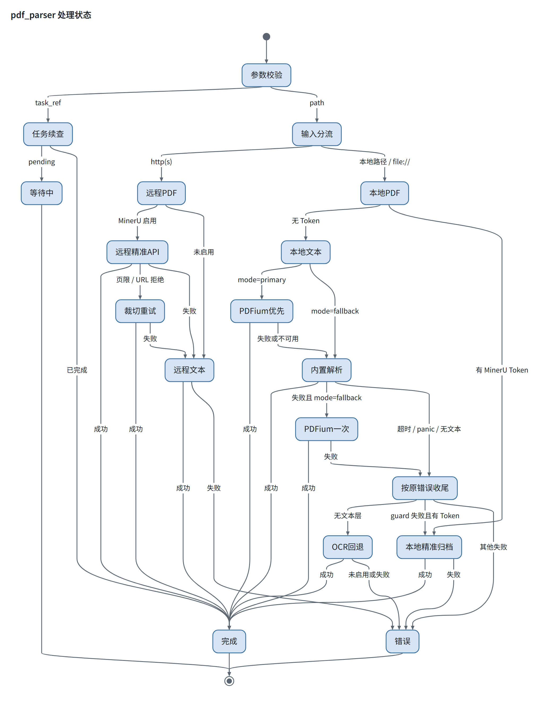

# 本地 PDF 文本解析器：ledongthuc 对照评估

日期：2026-11-14。语料与复现见 [`bench/pdfcorpus/`](../bench/pdfcorpus/)。

本仓库本地廉价路径走 `go-webfetch` 的 `Page.GetPlainText`，底层是 [`ledongthuc/pdf`](https://github.com/ledongthuc/pdf)（`rsc/pdf` 的 fork）。精准路径走 MinerU。这次对照只回答一件事：**上游这个库日常够不够用，病态输入上差到什么程度。**

## 结论

日常结构正常的 PDF，ledongthuc 抽得出正文，作为「抓网页顺手取文本」的廉价路径够用。

上游 issue 里那类病态输入上明显偏弱。首轮 17 条合成语料里：

- 9 条抽出预期正文
- 7 条报错（其中 2 条是 panic：尾部换行 `index out of range [-1]`、负数 `startxref` `slice bounds out of range`）
- 1 条 **5 秒挂死**（循环 `/Kids`）

扩到 34 条后，又确认 `/Prev` 环（`circular_prev`）也挂死（>60 秒），`/Count 999999` 是 24.4 秒的 CPU 慢路径而不是死循环。挂死仍是 ledongthuc 独有的：MuPDF、PDFium、pdf.js、pypdf、pdfcpu 都在几十毫秒内识别页树环并返回错误；xpdf / Poppler 抽出文本后退出。

它不是「完全不能用」，也谈不上高质量解析器。定位维持：**进程内 recover + 超时 + 堆增长看门狗挡住挂死/panic；畸形失败先尝试可选的 PDFium 动态库（若已启用），再升级 MinerU。** 发货形态仍是纯 Go、无 CGO、MIT；PDFium 作为可选动态库在运行时懒加载，不链接进主二进制，其余对照用 C 引擎只在独立 bench 里跑。

同一套语料上补测了 PDFium 的两种无 CGO 接入（动态库 + purego、WebAssembly + wazero）。两种都不再挂死，病态输入 5 秒内全部返回；常态 20 页 / 20 页 Flate 的中位耗时分别是 9.1 ms / 18.9 ms，ledongthuc 是 2.4 ms。动态库常驻约 23 MB，wasm 峰值约 500 MB、冷启动约 4.2 秒。数据与接入判断见 [`PDFium 两种接入的实测`](#pdfium-两种接入的实测2026-11-14-补测)。

## 测什么、不测什么

测的是解析器会不会被病态字节流弄坏（hang / panic / 死循环 / 拒收），以及打开之后能不能留下预期子串。

语料按 `ledongthuc/pdf` 的 crash/hang/OOM issue 手工构造，Helvetica `/F1`，无压缩流。覆盖：内嵌图 `BI/EI`、缺 Tf 操作数、空 `TJ`、`"` 操作符、多余 `Q`、未闭合数组/十六进制、跨流数组、文件尾换行、缺 `%%EOF`、负数 `startxref`、`/Size 2^62`、TJ 字距、Form XObject、循环页树、空页。另加一条正常对照 `healthy`。

不测 OCR、多栏、表格、扫描件、真实论文排版。那是 MinerU 的范围，这次分数说明不了「抽正文好不好看」。

## 引擎怎么接进来

不在本机从源码编 MuPDF / PDFium / Rust。C 实现走捆绑库、官方 wheel 或预编译 CLI。排除 Java / C#。Rust 没找到现成的文本抽取 CLI，未纳入。UniPDF 需要运行时 license key，未跑。

| 引擎 | 内核 | 接入 |
|------|------|------|
| **ledongthuc** | Go tokenizer | 本仓库现用，`github.com/ledongthuc/pdf` |
| pdfcpu | 纯 Go 结构库 | 库 `v0.16.4` + 官方 Windows zip CLI |
| go-fitz | MuPDF C | `gen2brain/go-fitz` 捆绑库，Windows 经 purego 加载 |
| pymupdf | MuPDF C | PyPI wheel 2.1（MuPDF 1.28.6） |
| pypdfium2 | PDFium C | PyPI wheel 5.15.2 |
| pypdf | 纯 Python | PyPI 7.1.0 |
| pdfminer.six | 纯 Python | PyPI 20260107 |
| xpdf | C CLI | 本机 `pdftotext` 4.00（Glyph & Cog） |
| poppler | C CLI | 预编译 `pdftotext` 26.09.0 |
| pdf.js | JS | `pdfjs-dist` npm |

每个 `(引擎, 用例)` 单独子进程，5 秒杀掉。主模块不引入这些依赖，bench 是独立 `go.mod`。

判定：`OK` = 打开且保留预期子串；`miss` = 打开但预期子串不在输出里；`err` = 进程返回错误；`TIMEOUT` = 5 秒被杀；`+form` = 额外抽出 Form XObject 文本。pdfcpu 抽的是原始内容流字节，它的 `OK` 表示流里有子串，不是排版后文本。

## 结果（2026-11-14）

| case | ledongthuc | pdfcpu | go-fitz | pymupdf | pypdfium2 | pypdf | pdfminer | xpdf | pdfjs | pdfcpu-cli | poppler |
|---|---|---|---|---|---|---|---|---|---|---|---|
| healthy | OK | OK | OK | OK | OK | OK | OK | OK | OK | OK | OK |
| inline_image | OK | OK | OK | OK | OK | OK | OK | OK | OK | OK | OK |
| bad_tf | err | OK | miss | err | err | OK | err | miss | err | OK | miss |
| empty_tj | err | OK | err | err | err | err | err | OK | err | OK | OK |
| quote_operator | err | OK | miss | miss | OK | OK | miss | OK | miss | OK | OK |
| extra_q | OK | OK | OK | OK | OK | OK | OK | OK | OK | OK | OK |
| unterminated_array | OK | OK | OK | OK | OK | OK | OK | OK | OK | OK | OK |
| unterminated_hex | OK | OK | err | err | err | err | err | OK | err | OK | OK |
| split_stream | OK | miss | OK | OK | OK | OK | OK | OK | OK | miss | OK |
| trailing_newlines | err | OK | OK | OK | OK | OK | OK | OK | OK | OK | OK |
| missing_eof | err | OK | OK | OK | OK | err | OK | OK | OK | OK | OK |
| negative_startxref | err | err | OK | OK | OK | OK | OK | OK | OK | err | OK |
| huge_size | OK | OK | OK | OK | OK | OK | OK | OK | OK | OK | OK |
| tj_kerning | OK | OK | OK | OK | OK | OK | OK | OK | OK | OK | OK |
| form_xobject | OK | OK | OK+form | OK+form | OK+form | OK+form | OK+form | miss | OK+form | OK | miss |
| cyclic_pages | TIMEOUT | err | err | err | err | err | err | OK | err | err | OK |
| empty_page | err | OK | err | err | err | err | err | OK | err | OK | OK |

ledongthuc 报错原文（worker 把 panic 打成 exit 2）：

| case | 现象 |
|------|------|
| bad_tf / empty_tj / quote_operator / empty_page | `no text` |
| trailing_newlines | `runtime error: index out of range [-1]` |
| missing_eof | `not a PDF file: missing %%EOF` |
| negative_startxref | `runtime error: slice bounds out of range [:4097] with capacity 4096` |
| cyclic_pages | 5s TIMEOUT |

其余引擎对 `cyclic_pages` 的反应都是识别环：go-fitz `cycle in page tree`，pypdf `Detected cyclic page references`，pdfcpu `missing parent node`，pypdfium2 `Failed to load page`。xpdf / Poppler 打开后给出文本。

## 对照读法

**正常文件。** `healthy`、内嵌图、多余 `Q`、未闭合数组、超大 `/Size`、TJ 字距：全场 OK。ledongthuc 在「文件大体合法」时和其他库同一档。

**结构修复。** 尾部换行、缺 `%%EOF`、负数 `startxref`：MuPDF / PDFium / pdf.js / Poppler 都能打开并留下正文。ledongthuc 两条 panic、一条拒收。这是 tokenizer 对 xref/EOF 的脆弱点，解释器类已经消化掉了。

**页树环。** 这是 ledongthuc 相对社区库真正差的那一档：别人当错误返回，它会挂。生产上这就是进程内超时看门狗要挡的对象；批量分页解决不了，因为挂在页树遍历，与页数无关。

**操作符容错。** 缺 Tf 操作数、空 `TJ`、`"` 操作符：解释器之间也互相 miss/err，ledongthuc 并不孤单。空页「无文本」同样是多数引擎的共同结果。

**Form XObject。** 解释器（MuPDF / PDFium / pdf.js / pypdf / pdfminer）会顺带抽出表单 XObject 里的 `form text`。ledongthuc 和 pdfcpu、xpdf、Poppler 只留下页内容流里的 `retained text`。这是能力边界，不是崩溃。

**pdfcpu。** 适合当结构工具，不适合当文本抽取器。`split_stream` 的 miss 是因为预期子串 `retained text` 被拆成 `(retained)( text)`，原始流对不上。CLI 与库在修了 `-m content` 之后口径一致。

## 对本仓库的含义

1. **ledongthuc 的真实风险是挂死和 panic，不是普通正文抽不出来。** 进程内 guard（recover、超时、堆增长）对准的就是这 3 个 case；报 `no text` 的畸形文件走 MinerU 升级。
2. **Go 里没有 MuPDF 这一档的纯 Go MIT 文本抽取器。** pdfcpu 停在内容流；UniPDF 是专有协议；Aspose FOSS / razvan / go-fast-pdf 还在 0.x，没有解释器类的病态表现。
3. **解释器内核可以以外挂动态库接入，不必 CGO、不必把主二进制改成非 MIT。** 见下一节。主程序仍是纯 Go；有 `pdfium.dll` / `libpdfium.so` 时走 PDFium，没有时继续 ledongthuc。
4. 语料是合成的。若以后要评「论文好不好读」，需要真实 PDF 集，和本 bench 分开。

## 解释器内核：Win/Linux 动态库（无 CGO）

对照里病态表现更好的是 C 解释器（MuPDF / PDFium / Poppler）。主程序要保持 MIT、无 CGO、Win + Linux 主力。能同时满足「许可可随 MIT 程序分发」和「现成 Win/Linux 预编译动态库」的，只有 PDFium。

| 内核 | 许可 | Win/Linux 预编译动态库 | 文本抽取 | 无 CGO 接入 | 结论 |
|------|------|------------------------|----------|-------------|------|
| **PDFium** | BSD-3-Clause（Chromium）；打包脚本 MIT | 有，[pdfium-binaries](https://github.com/bblanchon/pdfium-binaries) 每周构建 `pdfium-win-x64` / `linux-x64` / `linux-arm64` | 有（`FPDFText_*`） | `ebitengine/purego` 对 `pdfium.dll` / `libpdfium.so` 做 C ABI | **选这个** |
| MuPDF | AGPL-3.0 或 Artifex 商业许可 | 有 | 有 | 动态加载仍受 AGPL 约束 | 排除 |
| Poppler / xpdf | GPL | 有 | 有 | 同上 | 排除 |
| qpdf | Apache-2.0 | 有 | 结构工具，不是文本解释器 | — | 不适合本场景 |
| hayro（Typst，纯 Rust） | MIT / Apache-2.0 | 无现成 cdylib | 实验性渲染器，性能未作为目标 | 要自己在 CI 交叉编 Win/Linux | 太早 |
| lopdf / pdf-rs / pdf-extract | MIT 或未声明 | 无稳定抽取 ABI | 结构/窄抽取，不是 PDFium 档 | — | 补强有限 |
| pdf.js | Apache-2.0 | 无 DLL，主体是 JS | 有 | 要 JS 运行时 | 不如 PDFium |

## PDFium 两种接入的实测（2026-11-14 补测）

### 怎么接的、怎么计时

- `pdfium-dll`：`ebitengine/purego` 运行时 `LoadLibrary` / `dlopen`，绑定 `FPDF_InitLibrary`、`FPDF_LoadMemDocument`、`FPDF_GetPageCount`、`FPDF_LoadPage`、`FPDFText_LoadPage`、`FPDFText_CountChars`、`FPDFText_GetText` 等 12 个符号，UTF-16LE 解码。主程序不需要 CGO。
- `pdfium-wasm`：`klippa-app/go-pdfium` v1.21.4 的 `webassembly` 后端（wazero），池 `MinIdle=MaxIdle=MaxTotal=1`，一个实例复用；模块编译一次，后续抽取不再编译。
- 病态判定：每个 `(引擎, 用例)` 独立子进程。worker 初始化完成后在 stderr 打 `PDFCORPUS_READY`，父进程从这一刻起计 5 秒，`TIMEOUT` 只表示抽取阶段挂死。wasm 冷编译约 4 秒，不进入判定，也不会被误判成超时。
- 常态计时：同一进程内先加载引擎，每个 fixture 预热后跑 7 轮；每轮 1 页 500 次、20 页 20 次，取每轮平均，再取 7 轮中位。文件读取在计时外；ledongthuc 走 `pdf.NewReader` 内存解析，与 DLL / wasm 的 `LoadMemDocument` 同口径。
- 两个后端都用 `CGO_ENABLED=0` 构建并实跑通过；bench 里只有 go-fitz 仍需 CGO，CGO=0 时自动跳过。
- 版本：DLL 取 [pdfium-binaries](https://github.com/bblanchon/pdfium-binaries) 的 `pdfium-win-x64.tgz`（chromium/8152，无 V8/XFA，x64，2026-11-10 构建）；wasm 是 go-pdfium v1.21.4 内嵌模块。两者是不同构建，个别畸形输入的接受度不完全一致。

### 病态语料（34 条）

| case | ledongthuc | PDFium DLL | PDFium wasm |
|---|---|---|---|
| healthy | OK | OK | OK |
| inline_image | OK | OK | OK |
| bad_tf | err | err | err |
| empty_tj | err | err | err |
| quote_operator | err | OK | OK |
| extra_q | OK | OK | OK |
| unterminated_array | OK | OK | OK |
| unterminated_hex | OK | err | err |
| split_stream | OK | OK | OK |
| trailing_newlines | err | OK | OK |
| missing_eof | err | OK | OK |
| negative_startxref | err | OK | OK |
| huge_size | OK | OK | OK |
| tj_kerning | OK | OK | OK |
| form_xobject | OK+form | OK+form | OK+form |
| cyclic_pages | TIMEOUT | err | err |
| empty_page | err | err | err |
| indirect_kids | OK | OK | OK |
| stray_brace | miss | OK | OK |
| deep_dict | OK | OK | OK |
| circular_prev | TIMEOUT | OK | OK |
| parent_number | OK | OK | OK |
| comment_storm | OK | OK | OK |
| self_length | err | OK | OK |
| empty_kids | err | err | err |
| huge_length | OK | OK | OK |
| cyclic_form | OK | OK | OK |
| count_mismatch | TIMEOUT | OK 632ms | err |
| nested_q | OK | OK | OK |
| flate_ok | OK | OK | OK |
| flate_garbage | err | err | err |
| null_kid | OK | err | err |
| missing_endstream | OK | OK | OK |
| truncated_xref | err | err | err |

legend: `OK` = 打开且保留预期正文；`miss` = 打开但预期子串不在；`err` = 返回错误；`TIMEOUT` = 5 秒被杀；`OK+form` = 额外抽出 Form XObject 文本。

- 34 条在两次完整跑批中判定完全一致；DLL 另跑 3 次，判定也一致。
- ledongthuc 的两条 `TIMEOUT` 里，`count_mismatch` 不是死循环：把上限放宽到 60 秒后 24.4 秒返回，是 `/Count 999999` 的 CPU 慢路径；`cyclic_pages` 和 `circular_prev` 超过 60 秒，是真挂死。
- PDFium 两种接入都没有 panic / SIGSEGV / 挂死。DLL 唯一超过 100 ms 的是 `count_mismatch` 的 632 ms；wasm 对同一输入直接报 `6: incorrect page`。
- `truncated_xref` 的 DLL 报 `FPDF_LoadMemDocument failed (no PDFium error code)`，仍然是安全拒收，不是崩溃。
- DLL 与 wasm 对 `unterminated_hex`、`null_kid`、`count_mismatch` 的接受度不同，属于两个 PDFium 构建的差异；作为「不挂死」的判定，两者都合格。

### 常态性能（warm process）

| 后端 | 1 页 | 20 页 | 20 页 Flate | 冷启动（进程启动 + 加载 + 抽 1 页） |
|------|------|-------|-------------|--------------------------------------|
| ledongthuc | 49–54 µs | 2.34–2.41 ms | 2.65–2.82 ms | 约 21 ms |
| PDFium DLL | 1.11–1.20 ms | 9.02–9.15 ms | 8.93–9.32 ms | 约 34 ms |
| PDFium wasm | 0.96–0.98 ms | 18.73–19.07 ms | 18.92–19.49 ms | 约 4.17 s |

区间来自 CGO=0 与 CGO 开启两次独立跑批；每轮内部波动约 ±5%，ledongthuc 20 页约 ±10%。1 页时 wasm 略快于 DLL（固定开销差异），到 20 页 DLL 反超约 2.1 倍；ledongthuc 在正常多页文件上比 DLL 快约 3.8 倍。

### 长跑与内存（5000 次 × 20 页，同一进程）

| 后端 | 总耗时 | 每次 | RSS 首个采样 | RSS 峰值 | RSS 后段 |
|------|--------|------|---------------|----------|----------|
| ledongthuc | 12.05 s | 2.41 ms | 17.4 MB | 20.5 MB | 17–20 MB |
| PDFium DLL | 45.43 s | 9.09 ms | 21.8 MB | 22.9 MB | 22.5 MB |
| PDFium wasm | 94.61 s | 18.92 ms | 354 MB @500 次 | 503 MB @2000 次 | 98.5 MB @2500–5000 次 |

wasm 在只抽 1 次时的基线就有约 293–329 MB；20 页压力下峰值升到约 503 MB，2500 次后又回落到 98.5 MB 并保持到 5000 次。这个窗口内没有看到单调泄漏，但峰值约为 DLL 的 22 倍，长时间驻留的真实 PDF 混合负载还需要更长的 soak 复核。

### 怎么读这组数

**稳定性。** PDFium 两条路都消除了 ledongthuc 的挂死和 panic。DLL 对畸形输入更宽容（`count_mismatch` 能出正文、`null_kid` / `self_length` 能打开），wasm 更严格、拒收更快。两者都没有崩溃；生产上仍然建议保留 worker 外部的超时和重启，因为 C 层故障不在这套 bench 的覆盖范围内。

**速度。** 多页正常文件的排序是 ledongthuc < DLL < wasm。DLL 比 wasm 快约 2.1 倍，和 go-pdfium 上游「wasm 约为原生 2.1 倍」的口径一致。ledongthuc 虽然最快，但两条真挂死 + 两条 panic 是它必须靠 guard 兜底的代价。

**内存与冷启动。** DLL 常驻 22.5 MB、进程冷启动 34 ms；wasm 常驻基线约 300 MB、峰值约 500 MB、冷启动 4.17 s。wasm 只适合「没有 DLL 可选」的长生命周期退路，不适合每请求 fork 或频繁重启的形态。

**对本仓库的接入判断。** 采用「默认 ledongthuc + guard；有 PDFium 动态库时先试一次，`mode: primary` 可整体切到 DLL；wasm 只当无 DLL 退路」。这次实测确认了 DLL + purego 的无 CGO 可行性，也给出了 wasm 的内存/启动预算。仓库已落地「ledongthuc 快路径 + 失败才切 PDFium」的 fallback 模式：正常文件保持 2.4 ms，失败后才吃 9 ms 的 DLL 成本；也可配置 `primary` 让所有 PDF 直接走 PDFium。

### 接入形态（按适合本服务排序）

1. **首选：PDFium 无 V8 动态库 + purego，懒加载，单独常驻 worker。**  
   主 MCP 进程仍 `CGO_ENABLED=0`、MIT。第一次要解析 PDF 时再 `LoadLibrary`/`dlopen`（exe 旁、配置目录）。文本只调 `FPDF_LoadMemDocument` / `FPDFText_LoadPage` / `FPDFText_GetText` 十来个符号。PDFium 非完全线程安全，调用需串行。  
   生产形态建议把动态库放进**独立长生命周期进程**（进程数=1，不是每请求 fork）：C 层 SIGSEGV 只打死 worker，主服务拉起来再跑；实测常驻 RSS 22.5 MB，不是 N 个子进程。这和现有「进程内 goroutine 挡不住 C 崩溃」对得上。**仓库当前先落地为进程内串行实验版**，worker 隔离尚未实现。  
   预编译取无 V8 档（`pdfium-win-x64.tgz` / `pdfium-linux-x64.tgz` / `pdfium-linux-arm64.tgz`）。PDF 内嵌 JS 用不到，体积更小。分发时带上 PDFium 的 BSD 与第三方 NOTICE。

2. **动态库不在时：继续 ledongthuc + 现有 guard，失败升级 MinerU。** 默认零依赖行为不变。

3. **WASM 只当没有 DLL 的第三档，而且要跑 PDFium 的 wasm，不要把 Go 编成 wasm。**  
   [klippa-app/go-pdfium](https://github.com/klippa-app/go-pdfium) 的 wazero 后端是同一套 PDFium，纯 Go 宿主，许可 MIT。本次实测 20 页 18.9 ms，约为 DLL 的 2.1 倍（与上游 5000 份语料上约 2.1 倍的说法一致）；冷启动 4.17 s、常驻基线约 300 MB、峰值约 500 MB。Go 编出来的 wasm 和这不是一条路，不采用。Win/Linux 都能拿到官方 `.dll`/`.so`，没有必要默认走 wasm。

**不采用：** klippa 的 native 后端（CGO）；把 PDFium 链进主进程（C 崩溃会带倒 MCP）；为 hayro/Rust 自建 cdylib 矩阵（没有预编译、成熟度不够）。

### 本仓库已落地的实验性接入（2026-11-14）

配置放在 `pdf_parser.pdfium`，省略 `enabled` 时按自动检测处理：

```yaml
pdf_parser:
  pdfium:
    # 三态：省略=自动检测（库存在则启用 fallback）；true=强制启用；false=关闭
    enabled: true
    path: ""        # 空=平台默认 pdfium.dll / libpdfium.so；相对路径按 exe、exe/third_party/pdfium/<架构>、配置目录、配置目录/third_party/pdfium/<架构> 依次查找
    mode: fallback  # fallback（默认）| primary
```

分发与查找：

- 平台整包（Windows `.zip`、Linux/macOS `.tar.gz`）在 `third_party/pdfium/<架构>/` 携带标准预编译库，随包附 `LICENSE`、`licenses/` 与 `VERSION`。
- 版本固定为 [pdfium-binaries](https://github.com/bblanchon/pdfium-binaries) 的 `chromium/8152`（PDFium 159.0.8152.0，无 V8/XFA）；CI 用 `third_party/pdfium/fetch.sh` 下载并按固定 SHA-256 校验后打包。
- 架构目录：`win-x64`、`linux-x64`、`linux-arm64`、`mac-x64`、`mac-arm64`。每个平台压缩包只带当前架构的一份；`linux-arm64` 供容器或手工部署使用，不随 GitHub Release 整包发布。
- 查找顺序：可执行文件目录 → 其 `third_party/pdfium/<架构>/` → 配置目录 → 其 `third_party/pdfium/<架构>/`。手工放在根目录的库优先于整包副本。
- **Linux 实测（2026-11-14，WSL）**：Ubuntu 22.04 / Go 1.27.1，官方 `pdfium-linux-x64`（Chromium 8152，SHA-256 校验一致）下 `TestExtractFromBundledPath`、`TestExtractWithDLL` 与真实链路 `TestParseLocalPDF_RealPDFiumPrimary/Fallback` 通过；全量 `go test -short ./...` 仅 PubMed 既有网络 flake，单独重跑通过。

处理状态：



图源：[`docs/images/src/pdf-parser-state.md`](images/src/pdf-parser-state.md)。修改后用 `mmdx docs/images/src/pdf-parser-state.md -o docs/images/pdf-parser-state.png --width 1280 --scale 2 --title "pdf_parser 处理状态"` 重新渲染。

行为：

- **懒加载**：启动时不加载动态库；首次解析本地 PDF 需要 PDFium 时才 `LoadLibrary`/`dlopen`。自动检测模式（省略 `enabled`）在库缺失时保持静默，显式 `enabled: true` 时记一次告警。库缺失时下一次解析会重新检查搜索目录；库存在但加载失败（架构/符号不匹配）会缓存错误到进程重启。两种情况都继续纯 Go 路径。
- **fallback**：先走 ledongthuc + guard；失败后尝试一次 PDFium。成功则返回 `ParseEngine=pdfium`，失败则保留原始错误继续 guard / MinerU 链路。
- **primary**：先走 PDFium；失败后回退 ledongthuc，再进入既有 guard / MinerU 链路。
- **页选择**：`pages` 透传为 1-based 页码，按升序去重并过滤越界；省略时按 `max_pages` 截前 N 页。输出按页用 `\n\n---\n\n` 分隔。
- **进程内串行**：PDFium 非完全线程安全，所有调用用进程级互斥锁串行；C 层 SIGSEGV 无法被 Go recover，生产部署仍建议独立 worker 隔离。当前实现是实验性进程内接入。
- **许可与构建**：主程序保持纯 Go / 无 CGO / MIT；动态库按需加载，不链接进主二进制。随包分发 PDFium 时需带 BSD-3 与第三方 NOTICE。

本仓库 corpus 里 `pypdfium2` 已经是这份 PDFium 内核：循环页树报错退出、缺 EOF / 负数 xref / 尾部换行能留下正文、Form XObject 能抽出表单字。外挂动态库要的就是这一档表现。
